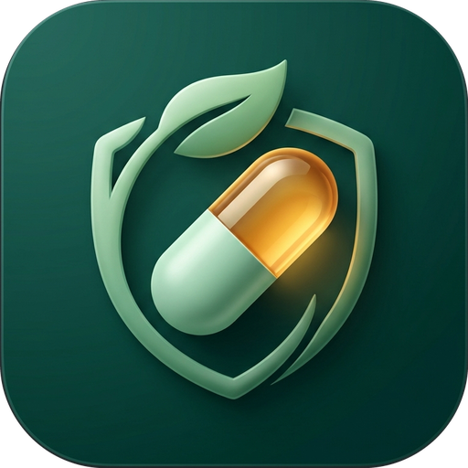
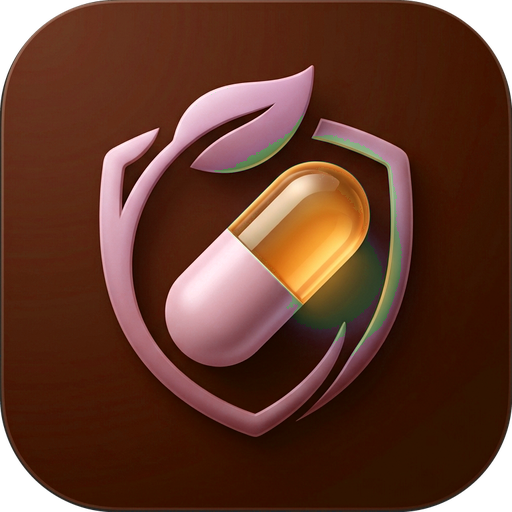
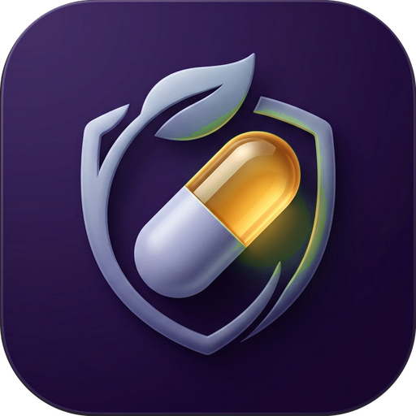

<p align="center">
  
</p>

<h1 align="center">DoseSaathi</h1>

<p align="center">
  <strong>A Warm, Trustworthy & Offline-First Family-Connected Medicine Companion</strong>
</p>

<p align="center">
  <a href="https://github.com/shibu2000/DoseSaathi/releases/latest"></a>
  <a href="https://github.com/shibu2000/DoseSaathi/blob/main/LICENSE"></a>
  
  
  
</p>

<p align="center">
  <a href="#-about-dosesaathi"><b>📖 About</b></a> •
  <a href="#-direct-downloads--latest-builds-v106"><b>⬇️ Download APK</b></a> •
  <a href="#-key-capabilities--highlights"><b>✨ Features</b></a> •
  <a href="#-four-signature-appearance-themes"><b>🎨 Themes</b></a> •
  <a href="#%EF%B8%8F-repository-architecture"><b>🏗️ Architecture</b></a> •
  <a href="#-local-development-setup"><b>🚀 Quickstart</b></a>
</p>

---

## 📖 About DoseSaathi

DoseSaathi is an open-source, offline-first medicine reminder companion created to bridge the gap between clinical adherence and compassionate care.

Most medication apps today are designed either as soulless clinical alarms or cluttered ad-driven platforms requiring user accounts, passwords, and persistent cloud connectivity. DoseSaathi is built differently: it treats medication adherence not as a stressful chore, but as a calm, trustworthy daily routine designed specifically for elderly individuals, chronic care patients, and the families who care for them.

### 🎯 The Challenge: Why Typical Reminder Apps Fail
- **Alarm Anxiety & Startling Beeps**: Shrill, piercing electronic beeps trigger anxiety and are often reflexively dismissed or muted.
- **Inaccessible, Cluttered Interfaces**: Tiny fonts, crowded forms, and ambiguous icons make standard apps frustrating for seniors, users with low vision, or those with hand tremors.
- **Privacy Vulnerabilities & Cloud Lock-in**: Demanding personal email signups and storing sensitive prescription data on third-party cloud servers risks privacy and fails without an active internet connection.
- **Silent Notification Drops**: Standard background notifications get silently suppressed by aggressive battery optimizations (Doze mode) or lost under social media clutter.

### 💡 The DoseSaathi Philosophy: Modern Clinical + Warm Human
- 🌿 **Calm & Dignified Experience**: Gentle spoken announcements (*"It's time for your medicine"*) and soothing chimes replace jarring siren beeps.
- 👓 **Elderly-Friendly Accessibility**: Integrated Atkinson Hyperlegible Next typography, high-contrast visual tokens, generous touch targets (≥56px), and Dynamic Type scaling ensure effortless readability.
- 🔒 **100% Offline Autonomy**: Your medicines, schedules, and dose records remain strictly in an encrypted local SQLite database on your device. Zero tracking, zero accounts, zero ads.
- ⏰ **Unmissable Over-Lockscreen Alerts**: Built on native Android `AlarmManager.setExactAndAllowWhileIdle()` and Full-Screen Intents, alerts reliably wake the device and display over the lock screen even in deep sleep or offline mode.
- 🤝 **Privacy-First Family Connection**: Patients can securely share schedule visibility with loved ones using an ephemeral 6-digit sync code or QR code—no passwords, no tracking, and access can be revoked instantly at any time.

### 👥 Who Is DoseSaathi For?
- **Elderly & Senior Adults**: Clear, high-contrast displays with spoken voice announcements and mistake-proof single-tap dose confirmations with a 5-minute safety undo window.
- **Chronic Care Patients**: Flawless support for complex regimens—multi-dose daily schedules, cyclical ON/OFF intervals (e.g. 21 days ON, 7 days OFF), dependent doses, and multi-week tapering courses.
- **Family Caregivers**: Remote reassurance and real-time adherence visibility for aging parents or loved ones living across town or across the globe.

---

## 📥 Direct Downloads & Latest Builds (v1.0.6)

Download the pre-compiled production packages directly from [GitHub Releases](https://github.com/shibu2000/DoseSaathi/releases/latest):

| Package | Platform | Target Architecture | Size | Who is this for? | Download Link |
|:---|:---|:---|:---|:---|:---:|
| **`dosesaathi-arm64-v8a-release.apk`** | Android | `arm64-v8a` | **46 MB** | **⭐ Recommended for 99% of Android phones** (Samsung, Pixel, OnePlus, Xiaomi, Vivo, Oppo, Realme, Motorola, etc.). Fastest performance and smallest download size. | [⬇️ Download APK](https://github.com/shibu2000/DoseSaathi/releases/latest/download/dosesaathi-arm64-v8a-release.apk) |
| **`dosesaathi-universal-release.apk`** | Android | All (Universal) | **126 MB** | Universal compatibility for any Android device, older architectures, custom ROMs, or if you are unsure of your processor. | [⬇️ Download APK](https://github.com/shibu2000/DoseSaathi/releases/latest/download/dosesaathi-universal-release.apk) |
| **`dosesaathi-armeabi-v7a-release.apk`** | Android | `armeabi-v7a` | **37 MB** | For older 32-bit legacy Android smartphones (released before 2017). | [⬇️ Download APK](https://github.com/shibu2000/DoseSaathi/releases/latest/download/dosesaathi-armeabi-v7a-release.apk) |
| **`dosesaathi-x86_64-release.apk`** | Android | `x86_64` | **48 MB** | For Android Studio emulators and ChromeOS/PC Android environments. | [⬇️ Download APK](https://github.com/shibu2000/DoseSaathi/releases/latest/download/dosesaathi-x86_64-release.apk) |
| **`DoseSaathi-Simulator.zip`** | iOS | Simulator (x86_64 / arm64) | **~35 MB** | For macOS iOS Simulator testing. Unzip and drag `DoseSaathi.app` directly into Xcode Simulator. | [⬇️ Download ZIP](https://github.com/shibu2000/DoseSaathi/releases/latest/download/DoseSaathi-Simulator.zip) |
| **`DoseSaathi-Unsigned.ipa`** | iOS | Physical iPhone | **~35 MB** | For physical iPhones via sideloading (AltStore, Sideloadly, TrollStore, or free personal Xcode signing). | [⬇️ Download IPA](https://github.com/shibu2000/DoseSaathi/releases/latest/download/DoseSaathi-Unsigned.ipa) |

---

## 🎨 Four Signature Appearance Themes

DoseSaathi includes four bespoke visual palettes created to reflect healing, calm, and clarity:

<p align="center">
  
  &nbsp;&nbsp;&nbsp;&nbsp;&nbsp;&nbsp;
  
  &nbsp;&nbsp;&nbsp;&nbsp;&nbsp;&nbsp;
  
  &nbsp;&nbsp;&nbsp;&nbsp;&nbsp;&nbsp;
  
</p>

| Theme | Primary Hex | Aesthetic & Feel |
|:---|:---:|:---|
| 🌿 **Nature Green** | `#006156` | Calm forest teal and gentle sage accents (Default). Grounded, organic, and restorative. |
| 🌊 **Ocean Blue** | `#026AA7` | Crisp, clinical, and clean modern aesthetic. High clarity and focus. |
| 🌅 **Sunset Warm** | `#C85A17` | Warm terracotta and golden amber tones. Friendly, comforting, and approachable. |
| 🪻 **Lavender Calm** | `#6B4FA2` | Soft amethyst and gentle lavender glow. Relaxing and soothing. |

> 💡 **Dynamic Launcher Icon Switching**: Selecting any theme inside **Settings & Appearance** immediately updates the app's launcher icon outside the app on your Android home screen and app drawer using native `<activity-alias>` switching!

---

## ✨ Key Capabilities & Highlights

### 🎨 Modern Clinical + Warm Human Design
- **Elderly-Friendly Accessibility**: High-contrast typography scale (up to 32px headings), generous touch targets (≥56px), Dynamic Type font scaling, and zero tiny unreadable text.
- **Atkinson Hyperlegible Next Typography**: Integrated Atkinson Hyperlegible Next font family for maximum letterform distinction, optimized for seniors and users with low vision.
- **Complete Dark Mode**: Seamless high-contrast dark surfaces across all dashboard cards, modals, time selectors, unit pickers, and family pairing sheets.
- **Theme Persistence**: Visual preferences are stored in SQLite and synchronized across device reboots and notification interactions.

### ⏰ Mission-Critical Offline Alarms & Full-Screen Alerts
- **100% Offline-First Architecture**: Your medicines, schedules, and dose records are stored safely in an encrypted local SQLite database.
- **Reliable Wake-Lock Alarms**: Uses Android's `AlarmManager.setExactAndAllowWhileIdle()` and Full-Screen Intents (`USE_FULL_SCREEN_INTENT`) to ring over the lock screen even during battery optimization, Doze mode, or offline conditions.
- **Selectable Musical Ringtones & Caring Voice Prompts**: Choose between 3 distinct alarm styles (**Warm Companion** with 124 BPM acoustic groove and conversational hydration check-ins, **Melodic Pop Ringtone** with catchy glockenspiel bells, or **Classic Jingle** chime) paired with female or male voices and full in-app audio previews.
- **Gentle Spoken Announcements**: Caring voice announcements in warm female or calm male voice paired with vibration patterns.
- **Device Reboot Resilience**: Native `BOOT_COMPLETED` receiver automatically restores and reconciles all scheduled alarms upon phone reboot without opening the app or needing an internet connection.
- **Atomic 5-Minute Undo Window**: Dose confirmations and course completion transitions provide a safe 5-minute atomic rollback window to prevent accidental taps.

### 📱 Android Home Screen Live Widget
- Displays the **Next Upcoming Dose**, prescribed dosage quantity, and scheduled time.
- Features a **live minute-by-minute countdown ticker** (e.g., *In 24 mins*, *Due now*, *Snoozed 10m*).
- Adapts dynamically to the active color theme (Nature, Ocean, Sunset, Lavender).
- Tapping the widget opens the app directly into your daily schedule.

### 👨‍👩‍👧‍👦 Privacy-First Family & Caregiver Sync
- **No Passwords or Accounts Required**: Patients generate a secure 6-digit pairing code or QR code to share schedule visibility with loved ones.
- **Granular Access Control**: Patients choose exactly what caregivers can see or edit (read-only vs. plan management). Access can be revoked instantly at any time.
- **Zero Cloud Dependence**: If the internet is disconnected, local medicine reminders and adherence records continue uninterrupted.

---

## 🏗️ Repository Architecture

DoseSaathi is built as a high-performance monorepo powered by **Bun**:

```
medchain/
├── apps/
│   ├── mobile/                    # React Native Expo mobile application
│   │   ├── app/                   # File-based routing (Expo Router)
│   │   │   ├── (patient)/         # Patient personal dashboard, medicines, family tabs
│   │   │   ├── (caregiver)/       # Caregiver multi-person management views
│   │   │   ├── alarm/             # Full-screen over-lockscreen alarm UI
│   │   │   ├── medicine/          # 4-step medicine creation wizard
│   │   │   └── settings/          # Appearance, voices, profile & system permissions
│   │   ├── assets/                # Themed app icons, illustrations & voice chimes
│   │   ├── modules/medchain-alarm # Native Kotlin Android module for exact alarms & widgets
│   │   └── src/
│   │       ├── alarms/            # Native alarm scheduler & reboot reconciliation
│   │       ├── components/        # Reusable design system components
│   │       ├── database/          # SQLite database migrations & repositories
│   │       └── theme/             # Centralized ThemeContext & semantic tokens
│   └── api/                       # Cloudflare Workers pairing & caregiver sync server
├── packages/
│   ├── domain/                    # Pure TypeScript scheduling & timezone domain logic
│   └── contracts/                 # Shared data models, validation schemas & DTOs
├── assets/                        # High-resolution brand icons and visual collateral
└── dosesaathi-*.apk               # Compiled release packages
```

---

## 🚀 Local Development Setup

### Prerequisites
- [Bun](https://bun.sh/) (v1.2+)
- [Node.js](https://nodejs.org/) (v18+)
- Android Studio & Android SDK (API 34+)
- Xcode 15+ (for macOS iOS builds)

### 1. Install Dependencies
```bash
git clone https://github.com/shibu2000/DoseSaathi.git
cd DoseSaathi
bun install
```

### 2. Run Tests
```bash
bun test
```
*Executes all 205 monorepo test suites covering native alarm scheduling, SQLite migrations, course transitions, and caregiver synchronization.*

### 3. Start Expo Development Server
```bash
cd apps/mobile
bun run start
```

### 4. Build Android Release APK Locally
```bash
cd apps/mobile/android
./gradlew assembleRelease
```
*Generated APKs will be output to `apps/mobile/android/app/build/outputs/apk/release/`.*

---

## 📄 License

This project is licensed under the [MIT License](LICENSE).
Built with care for families everywhere. 💚
