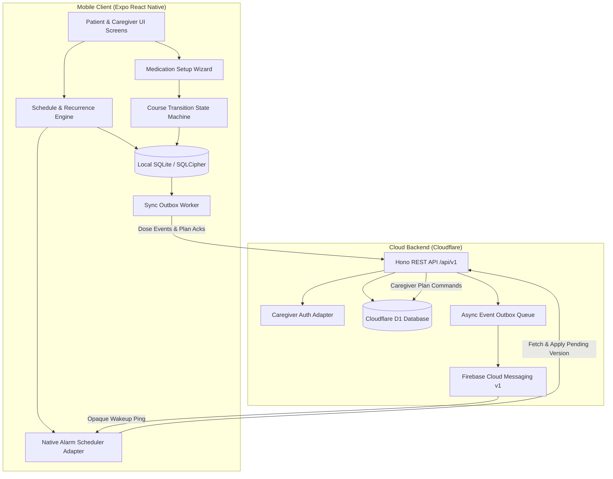

# MedChain — Architecture & System Design

**Version:** 1.0.0  
**Updated:** 8 November 2026  
**Status:** Canonical System Architecture Blueprint  

---

## 1. High-Level Architecture Overview

MedChain is an **offline-first personal and remote family medication management system**. The system is composed of:

1. **Mobile Application (Expo React Native + TypeScript)**:
   - Standalone Personal Mode: local SQLite persistence (`expo-sqlite`), native alarm scheduling (Android `AlarmManager.setAlarmClock()`, iOS `AlarmKit` / notification fallback), zero mandatory cloud dependency.
   - Remote Caregiver Mode: authenticated caregiver session, cryptographic pairing via QR / 6-digit session, versioned medication plan authoring, real-time activity observation.
2. **Cloud Backend (Hono on Cloudflare Workers + Cloudflare D1)**:
   - Stateless HTTP API at `/api/v1` validated with Zod.
   - Cloudflare D1 (distributed SQLite) for durable relationship, command queue, and dose event storage.
   - Cloudflare Queue / FCM push wake-up pipeline (sends opaque version hints only, never medication data).
3. **Shared Packages**:
   - `@medchain/contracts`: Zod schemas and TypeScript request/response contracts.
   - `@medchain/domain`: Pure TypeScript medication scheduling engine, recurrence calculations, course state transitions, and inventory forecasting.

---

## 2. Core Architectural Invariants

1. **Local Authoritativeness**: The patient device's local database is the single source of truth for medication alarms, taken/skipped actions, and active course states. The cloud is a coordination and synchronization layer.
2. **No False Success**: A plan command is only marked `APPLIED` when the patient device has transactionally committed it to SQLite and rescheduled its local alarms. Caregivers see `Waiting for device to connect` until explicit acknowledgement is received.
3. **Zero Leaked Clinical Data**: Push notifications (FCM) never contain patient names, medication names, dosages, or scheduling rules. Push notifications are purely wake-up doorbells containing an opaque version cursor.
4. **Pure Domain Logic**: All schedule calculation (fixed-time, cyclical ON/OFF, interval, same-day dependent) and course lifecycle math (fixed doses, fixed days, 5-minute undo) is isolated in pure TypeScript modules (`@medchain/domain`) free of UI or React Native dependencies, tested with 100% deterministic unit tests.
5. **Atomic Transactions**: Taking a dose, decrementing inventory, recording the dose log, scheduling dependent child doses, and enqueueing the local sync outbox event occurs in a single SQLite transaction.
