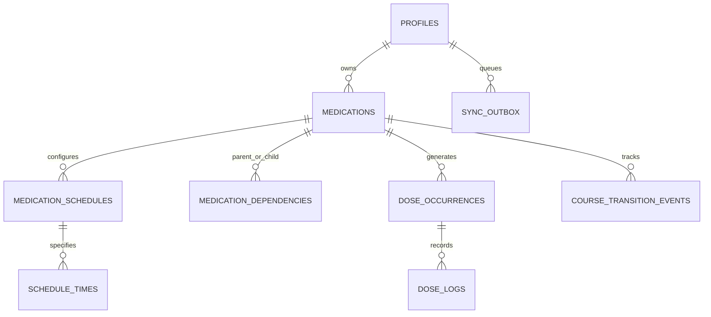

# MedChain — Data Model & Persistence Specification

**Version:** 1.0.0  
**Updated:** 8 November 2026  
**Status:** Approved Canonical Data Model  

---

## 1. Local SQLite Schema (Patient Device)

The local SQLite database is the primary source of truth for all patient operations. Migrations are strictly versioned (`001_initial_schema.sql`, etc.).

### 1.1 Tables Overview



### 1.2 Table Definitions

#### `profiles`
Represents the local patient profile on the device.
```sql
CREATE TABLE IF NOT EXISTS profiles (
  id TEXT PRIMARY KEY,               -- UUIDv4
  display_name TEXT NOT NULL,
  profile_type TEXT NOT NULL,        -- 'PERSONAL' | 'CARE_RECIPIENT'
  timezone_id TEXT NOT NULL,         -- e.g. 'America/New_York'
  created_at TEXT NOT NULL,          -- ISO 8601 UTC
  updated_at TEXT NOT NULL
);
```

#### `medications`
Represents a prescribed or self-administered medication.
```sql
CREATE TABLE IF NOT EXISTS medications (
  id TEXT PRIMARY KEY,               -- UUIDv4
  profile_id TEXT NOT NULL REFERENCES profiles(id) ON DELETE CASCADE,
  name TEXT NOT NULL,
  dosage_text TEXT NOT NULL,         -- e.g. "500 mg", "1 tablet"
  dose_quantity REAL NOT NULL DEFAULT 1.0,
  dose_unit TEXT NOT NULL DEFAULT 'tablet',
  instructions TEXT,                 -- e.g. "Take with food"
  lifecycle_status TEXT NOT NULL,    -- 'ACTIVE' | 'QUEUED_PHASE' | 'COMPLETED' | 'PAUSED'
  course_type TEXT NOT NULL,         -- 'ONGOING' | 'FIXED_DAYS' | 'FIXED_DOSES'
  course_start_at TEXT NOT NULL,     -- ISO 8601 UTC
  max_duration_days INTEGER,         -- For FIXED_DAYS
  max_total_doses INTEGER,           -- For FIXED_DOSES
  doses_taken_count INTEGER NOT NULL DEFAULT 0,
  track_stock INTEGER NOT NULL DEFAULT 0, -- 0 | 1
  current_stock REAL DEFAULT 0,
  low_stock_threshold REAL DEFAULT 5, -- Days remaining threshold
  version INTEGER NOT NULL DEFAULT 1,
  created_at TEXT NOT NULL,
  updated_at TEXT NOT NULL
);
```

#### `medication_schedules`
Defines the recurrence rules for generating dose occurrences.
```sql
CREATE TABLE IF NOT EXISTS medication_schedules (
  id TEXT PRIMARY KEY,               -- UUIDv4
  medication_id TEXT NOT NULL REFERENCES medications(id) ON DELETE CASCADE,
  schedule_type TEXT NOT NULL,       -- 'FIXED_TIMES' | 'INTERVAL' | 'SAME_DAY_DEPENDENT'
  recurrence_type TEXT NOT NULL,     -- 'DAILY' | 'SPECIFIC_DAYS' | 'CYCLE'
  start_date TEXT NOT NULL,          -- 'YYYY-MM-DD'
  timezone_id TEXT NOT NULL,
  interval_hours INTEGER,            -- For INTERVAL (2 - 24)
  cycle_days_on INTEGER,             -- For CYCLE
  cycle_days_off INTEGER,            -- For CYCLE
  cycle_anchor_date TEXT,            -- 'YYYY-MM-DD'
  active_weekdays_json TEXT,         -- JSON array: [1, 2, 3, 4, 5] (1=Mon)
  created_at TEXT NOT NULL,
  updated_at TEXT NOT NULL
);
```

#### `schedule_times`
Stores specific clock times for `FIXED_TIMES` schedules.
```sql
CREATE TABLE IF NOT EXISTS schedule_times (
  id TEXT PRIMARY KEY,
  schedule_id TEXT NOT NULL REFERENCES medication_schedules(id) ON DELETE CASCADE,
  local_time TEXT NOT NULL,          -- 'HH:MM' (24-hour format, e.g. "08:00")
  ordinal INTEGER NOT NULL DEFAULT 0
);
```

#### `medication_dependencies`
Encodes same-day and multi-day treatment course dependencies.
```sql
CREATE TABLE IF NOT EXISTS medication_dependencies (
  id TEXT PRIMARY KEY,
  parent_medication_id TEXT NOT NULL REFERENCES medications(id) ON DELETE CASCADE,
  child_medication_id TEXT NOT NULL REFERENCES medications(id) ON DELETE CASCADE,
  dependency_type TEXT NOT NULL,     -- 'SAME_DAY_AFTER_TAKEN' | 'AFTER_COURSE_COMPLETED'
  delay_minutes INTEGER DEFAULT 0,   -- For SAME_DAY_AFTER_TAKEN
  phase_delay_hours INTEGER DEFAULT 0,-- For AFTER_COURSE_COMPLETED
  fallback_policy TEXT,              -- 'SKIP_CHILD' | 'USE_FALLBACK_TIME'
  fallback_time TEXT,                -- 'HH:MM'
  created_at TEXT NOT NULL
);
```

#### `dose_occurrences`
Individual planned, scheduled, or due dose instances.
```sql
CREATE TABLE IF NOT EXISTS dose_occurrences (
  id TEXT PRIMARY KEY,               -- UUIDv4
  medication_id TEXT NOT NULL REFERENCES medications(id) ON DELETE CASCADE,
  scheduled_at_utc TEXT NOT NULL,    -- ISO 8601 UTC
  scheduled_local_date TEXT NOT NULL,-- 'YYYY-MM-DD'
  scheduled_local_time TEXT NOT NULL,-- 'HH:MM'
  timezone_id TEXT NOT NULL,
  state TEXT NOT NULL,               -- 'PLANNED' | 'SCHEDULED' | 'DUE' | 'TAKEN' | 'SKIPPED' | 'UNCONFIRMED'
  snoozed_until TEXT,                -- ISO 8601 UTC
  handled_at TEXT,                   -- ISO 8601 UTC
  source_alarm_id TEXT,
  created_at TEXT NOT NULL,
  updated_at TEXT NOT NULL
);
```

#### `dose_logs`
Immutable audit log of dose actions taken on the device.
```sql
CREATE TABLE IF NOT EXISTS dose_logs (
  id TEXT PRIMARY KEY,               -- UUIDv4
  medication_id TEXT NOT NULL REFERENCES medications(id) ON DELETE CASCADE,
  dose_occurrence_id TEXT REFERENCES dose_occurrences(id) ON DELETE SET NULL,
  scheduled_at TEXT NOT NULL,        -- ISO 8601 UTC
  action_taken TEXT NOT NULL,        -- 'TAKEN' | 'SKIPPED' | 'SNOOZED' | 'UNCONFIRMED'
  action_timestamp TEXT NOT NULL,    -- ISO 8601 UTC
  synced_to_cloud INTEGER NOT NULL DEFAULT 0,
  event_id TEXT UNIQUE NOT NULL      -- For deduplication
);
```

#### `course_transition_events`
Stores course completion transitions and enables 5-minute atomic Undo.
```sql
CREATE TABLE IF NOT EXISTS course_transition_events (
  id TEXT PRIMARY KEY,               -- UUIDv4
  source_course_id TEXT NOT NULL REFERENCES medications(id) ON DELETE CASCADE,
  activated_medication_ids_json TEXT NOT NULL, -- JSON array of child medication IDs
  prior_states_json TEXT NOT NULL,   -- Snapshot of prior states
  transition_timestamp TEXT NOT NULL,-- ISO 8601 UTC
  undo_until TEXT NOT NULL,          -- transition_timestamp + 5 minutes
  undone_at TEXT                     -- ISO 8601 UTC if undone
);
```

#### `sync_outbox`
Queues patient events to be uploaded to the cloud when connectivity is present.
```sql
CREATE TABLE IF NOT EXISTS sync_outbox (
  event_id TEXT PRIMARY KEY,         -- Idempotency key
  event_type TEXT NOT NULL,          -- 'DOSE_TAKEN' | 'DOSE_SKIPPED' | 'COURSE_COMPLETED' | 'PLAN_ACK'
  aggregate_id TEXT NOT NULL,        -- e.g. medication_id or occurrence_id
  payload_json TEXT NOT NULL,
  created_at TEXT NOT NULL,
  attempts INTEGER NOT NULL DEFAULT 0,
  next_retry_at TEXT,
  synced_at TEXT
);
```

---

## 2. Cloudflare D1 Cloud Schema

Enforced with relational foreign keys and indexes.

```sql
CREATE TABLE IF NOT EXISTS caregiver_users (
  id TEXT PRIMARY KEY,               -- External auth subject UUID
  email TEXT NOT NULL UNIQUE,
  display_name TEXT NOT NULL,
  created_at TEXT NOT NULL,
  updated_at TEXT NOT NULL
);

CREATE TABLE IF NOT EXISTS patient_devices (
  id TEXT PRIMARY KEY,               -- Opaque device UUID
  platform TEXT NOT NULL,            -- 'android' | 'ios'
  push_token TEXT,                   -- FCM device token
  app_version TEXT NOT NULL,
  last_seen_at TEXT NOT NULL,
  created_at TEXT NOT NULL
);

CREATE TABLE IF NOT EXISTS pairing_sessions (
  id TEXT PRIMARY KEY,               -- Session UUID
  patient_device_id TEXT NOT NULL REFERENCES patient_devices(id) ON DELETE CASCADE,
  code_hash TEXT NOT NULL,           -- SHA-256 of 6-digit PIN
  secret_hash TEXT NOT NULL,         -- SHA-256 of QR payload secret
  status TEXT NOT NULL,              -- 'PENDING' | 'CONSUMED' | 'EXPIRED' | 'REVOKED'
  failed_attempts INTEGER NOT NULL DEFAULT 0,
  expires_at TEXT NOT NULL,
  created_at TEXT NOT NULL
);

CREATE TABLE IF NOT EXISTS connection_requests (
  id TEXT PRIMARY KEY,
  pairing_session_id TEXT NOT NULL REFERENCES pairing_sessions(id) ON DELETE CASCADE,
  caregiver_user_id TEXT NOT NULL REFERENCES caregiver_users(id) ON DELETE CASCADE,
  requested_permissions_json TEXT NOT NULL,
  status TEXT NOT NULL,              -- 'PENDING' | 'APPROVED' | 'DECLINED' | 'CANCELLED'
  responded_at TEXT,
  created_at TEXT NOT NULL
);

CREATE TABLE IF NOT EXISTS relationships (
  id TEXT PRIMARY KEY,               -- UUID
  patient_device_id TEXT NOT NULL REFERENCES patient_devices(id) ON DELETE CASCADE,
  caregiver_user_id TEXT NOT NULL REFERENCES caregiver_users(id) ON DELETE CASCADE,
  relationship_label TEXT NOT NULL,  -- e.g. "Mom", "Arthur Vance"
  status TEXT NOT NULL,              -- 'ACTIVE' | 'REVOKED_BY_PATIENT' | 'DISCONNECTED_BY_CAREGIVER'
  permissions_json TEXT NOT NULL,    -- JSON array of approved permissions
  confirmed_at TEXT NOT NULL,
  revoked_at TEXT,
  version INTEGER NOT NULL DEFAULT 1
);

CREATE TABLE IF NOT EXISTS sync_commands (
  id TEXT PRIMARY KEY,               -- Command UUID
  relationship_id TEXT NOT NULL REFERENCES relationships(id) ON DELETE CASCADE,
  plan_version INTEGER NOT NULL,
  payload_json TEXT NOT NULL,        -- Complete plan snapshot or diff
  status TEXT NOT NULL,              -- 'PENDING_DEVICE' | 'RECEIVED' | 'APPLIED' | 'REJECTED' | 'SUPERSEDED'
  created_at TEXT NOT NULL,
  received_at TEXT,
  applied_at TEXT,
  error_code TEXT
);

CREATE TABLE IF NOT EXISTS dose_events (
  event_id TEXT PRIMARY KEY,         -- Device event ID (idempotent)
  relationship_id TEXT NOT NULL REFERENCES relationships(id) ON DELETE CASCADE,
  medication_id TEXT NOT NULL,
  occurrence_id TEXT NOT NULL,
  event_type TEXT NOT NULL,          -- 'TAKEN' | 'SKIPPED' | 'SNOOZED' | 'UNCONFIRMED'
  scheduled_at TEXT NOT NULL,
  action_timestamp TEXT NOT NULL,
  timezone_id TEXT NOT NULL,
  created_at TEXT NOT NULL
);
```
