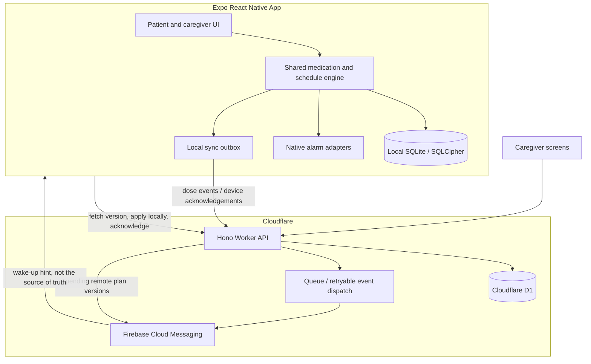
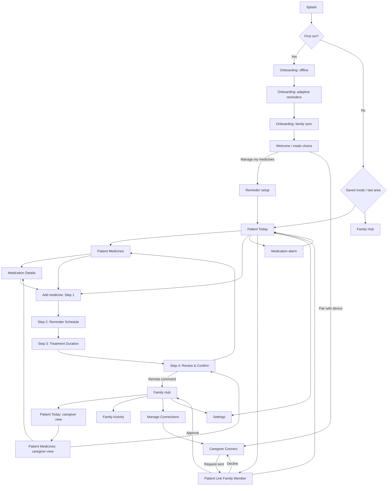

# MedChain — Mobile & Backend Development Blueprint

**Audience:** Antigravity and the developers implementing DoseSaathi  
**Product:** Offline-first Personal & Remote Family Medication Manager  
**Mobile:** React Native + Expo + TypeScript  
**Backend:** Hono on Cloudflare Workers + Cloudflare D1  
**Date reviewed:** 8 November 2026  
**Status:** Implementation blueprint based on the supplied Stitch archive, its two design documents, and the MedChain SRS previously supplied in this conversation.

---

## 0. Instructions for the coding agent

Read this document fully before changing the repository. Treat it as the implementation brief and preserve the scope already agreed for MedChain.

### Non-negotiable product rules

1. **Do not turn the app into a complex, stacked dashboard.** Keep screens simple, one main task per screen, and use inline states, dialogs, or bottom sheets where that avoids another screen.
2. **Do not build the HTML prototypes as WebViews.** The HTML and PNG files are visual/interaction references. Rebuild the UI as native React Native components. Browser APIs, DOM manipulation, `localStorage`, Tailwind CDN scripts, and HTML `window.location` navigation are not the application architecture.
3. **Local execution is the core product.** A patient must be able to create medicines, see today's plan, record doses, execute course transitions, and receive locally scheduled reminders without a server or account in Personal Mode.
4. **Remote caregiver features are an optional connected layer.** Cloud sync must never become a prerequisite for local patient alarms or local dose recording.
5. **Never show a successful action before it is confirmed.** A saved local plan, a request accepted by the server, a command received by the patient device, and a command applied locally are different states.
6. **Never invent medicine names, doses, timing, device status, permissions, encryption status, sync status, or connection metadata.** Use clearly labelled development fixtures only in development builds.
7. **Do not trust client-supplied identity.** The backend derives the authenticated caregiver from the access token and verifies the relationship on every patient-data request.
8. **Do not expose internal states in the UI.** Translate `QUEUED_PHASE` to “Starts after this course”; use plain-language labels for dose and sync states.
9. **Do not claim alarm reliability beyond what the OS, permission state, native implementation, and device allow.** Implement honest fallback states.
10. **Work phase by phase.** At the end of each phase, run tests, provide a concise implementation report, list unresolved decisions, and wait for the next implementation task rather than silently expanding scope.

### Safe repository workflow

- Inspect the existing repository before creating or replacing files.
- Do not overwrite existing code or configuration without explaining why and preserving useful work.
- Use TypeScript in the mobile app and API.
- Use the package manager already established in the repository. If starting from an empty repository, use a workspace setup with pinned lockfiles.
- Use `npx expo install` for Expo SDK packages so versions match the selected Expo SDK.
- Do not use Expo Go as the acceptance environment for the alarm implementation. Use a development build because the project needs custom native code.
- Keep secrets out of `.env` files committed to Git, source code, logs, test fixtures, and app bundles.
- Keep real patient information out of screenshots, fixtures, tests, and telemetry.

---

## 1. What was inspected

### 1.1 Supplied ZIP inventory

The archive `stitch_medchain_mobile_app.zip` contains:

- **23 `code.html` files**
- **24 `screen.png` files**
- **`design.md`** — the initial MedChain design and UX direction
- **`warm_editorial_healthcare/DESIGN.md`** — the expanded warm editorial design system
- **One illustration PNG without an HTML prototype** — `offline_medication_onboarding_illustration/screen.png`

The 23 HTML files are not 23 distinct product destinations. There are 21 canonical screen designs plus two alternate/duplicate variants:

- `medchain_splash_screen_1` and `medchain_splash_screen_2` are two splash variants. Use one only; the simpler warm-paper `medchain_splash_screen_2` is the preferred visual reference.
- `step_3_treatment_connections` is an alternate/older treatment-connection layout. Do not create an additional screen or form step from it. Use `treatment_duration_connections` as the canonical Step 3 screen, and keep same-day dose dependency in the Reminder Schedule step.
- `offline_medication_onboarding_illustration` is an asset, not a route.

### 1.2 Other source material

The MedChain SRS, previously supplied separately in this conversation, is **not included in this ZIP**. It is still a required functional source. It defines the offline-first model, medication schedules, dependent doses, multi-stage course transitions, native alarms, family pairing, sync, inventory, and the initial local data model.

Source hierarchy for implementation:

1. **SRS** for functional requirements and state-machine behavior.
2. **The two design documents** for design language, screen intent, accessibility and content voice.
3. **The canonical Stitch HTML/PNG files** for the current screen composition and interaction reference.
4. **This blueprint** for connecting those screens and translating the source requirements into an implementable Expo/Hono architecture. Any item identified below as an *open product decision* must be confirmed rather than silently treated as settled.

### 1.3 High-level audit result

The visual system is consistent enough to implement as a shared component library. The main gaps are not visual; they are around real persistence, native alarms, backend pairing, route identity, permissions, synchronization and a few missing destinations.

The HTML prototypes contain useful interaction examples, but many are browser simulations. Examples include localStorage-backed medication drafts and dose logs, fake timeouts for connection success, hardcoded permission status, sample family data, `href="#"`, and browser camera/audio interactions. None of those should be treated as implemented production behavior.

---

## 2. Product definition and scope

MedChain has two operating modes in one app.

### 2.1 Personal / standalone mode

- No registration is required.
- A local patient profile and medication data are created on the device.
- Medication schedules and dose history are stored locally in SQLite.
- The device executes reminder timing and course transitions locally.
- Local actions continue while offline.
- Cloud services are not required for the core experience.

### 2.2 Remote caregiver mode

- A caregiver authenticates to a caregiver account. The connection prototype explicitly shows a sign-in requirement before sending a connection request; the final authentication provider is still an open decision.
- The patient's phone creates a short-lived pairing session and displays a six-digit code or QR payload.
- The caregiver scans or enters the code and submits a connection request.
- The patient explicitly approves or declines the request on the patient device.
- The backend creates a relationship record with the exact approved permissions.
- The caregiver can create or modify a medication plan only when that relationship grants schedule-management permission.
- The patient device remains the local alarm executor and local record of actual patient dose actions.
- The caregiver sees a remote change as received/applied only after the patient device acknowledges the applied version.

### 2.3 Product features that must be implemented

- Fixed-time medication schedules.
- Selected weekdays.
- Cyclical ON/OFF treatment patterns.
- Repeating interval schedules.
- Same-day dependent reminders triggered only after the parent dose is marked **Taken**.
- Parent-dose snooze protection: snoozing a parent dose must not start the dependent-dose countdown.
- Parent-dose skip handling: ask whether to skip the dependent dose or use a prescribed fallback time.
- Ongoing, fixed-calendar-day and fixed-dose-count courses.
- One-to-many next-phase activation: a course can complete and activate follow-up medicines B, C and D.
- Optional delay between course completion and the next phase.
- Five-minute course-transition Undo, including restoration of the previous medication states and alarms.
- Local inventory decrement on **Taken** only; low-stock threshold at five days' supply remaining.
- Patient/caregiver pairing, consent, permissions, revocation, activity and remote sync.
- Device reboot and time/time-zone change alarm reconciliation.

### 2.4 Explicitly out of scope unless separately approved

- Diagnosis, medicine recommendations, clinical decision support or changing a doctor's prescription.
- Prescription OCR/photo extraction; the design document explicitly lists this as an open scope question.
- A web caregiver dashboard.
- Analytics charts or adherence scoring dashboards.
- Subscription/paywall implementation during the core adoption release.
- Multiple separate screens for every error, loading, offline or empty state. Use compact in-screen states unless the UX genuinely requires navigation.

---

## 3. Recommended technology architecture

### 3.1 Mobile stack

Use the current stable Expo SDK documented at implementation start. The current Expo documentation snapshot on 8 November 2026 lists **Expo SDK 58**, based on **React Native 0.88** and **React 19.3**, with a minimum Node.js version of **22.13.x**. Recheck this when creating the repository and commit the resulting lockfile; do not hand-pick mismatched Expo package versions.

Recommended mobile libraries and responsibilities:

| Concern | Recommended implementation |
|---|---|
| Framework | React Native + Expo + TypeScript |
| Navigation | Expo Router, typed file-based routes |
| Local database | `expo-sqlite` with migrations; enable SQLCipher for release builds if local database encryption is required |
| Database key / tokens | `expo-secure-store` for small secrets and key material, not for full database records |
| Local and remote notifications | `expo-notifications` for standard notification handling and supported scheduling |
| Alarm execution | Custom Expo native module(s): Kotlin/Android `AlarmManager`; Swift/iOS AlarmKit where available, with notification fallback |
| QR scanning | `expo-camera` native barcode/QR scanning |
| QR rendering | Native React Native QR component; do not inject browser SVG/DOM scripts |
| Clipboard | `expo-clipboard` |
| Fonts | Package Atkinson Hyperlegible Next with the app if licensing/build requirements permit; otherwise use a legible system fallback |
| Validation | Shared TypeScript domain types and Zod schemas for forms/API contracts |
| Forms | React Hook Form or a small controlled-form layer; do not create a large abstraction before needed |
| Server state | A query/cache layer such as TanStack Query for caregiver API data; local SQLite repositories remain the patient source of truth |
| App preferences | Small persisted preference store; critical data remains in SQLite |

Use an Expo development build from the beginning of native alarm work. Expo development builds support native libraries and native configuration that are unavailable in the standard Expo Go app. Use Expo Continuous Native Generation/config plugins for repeatable `AndroidManifest.xml` and iOS project configuration; keep custom native behavior in an Expo Module rather than repeatedly editing generated native files by hand.

### 3.2 Backend stack

| Concern | Recommended implementation |
|---|---|
| HTTP framework | Hono + TypeScript |
| Runtime/deploy | Cloudflare Workers |
| Database | Cloudflare D1 (SQLite) |
| Database migrations | Versioned SQL migrations applied through Wrangler |
| Authentication | Provider-neutral auth adapter; final identity provider must be selected before pairing is production-ready |
| Authorization | Hono middleware + relationship-scoped repository/service checks |
| Push | Firebase Cloud Messaging HTTP v1 as the SRS wake-up channel |
| Async push dispatch | Durable outbox plus Cloudflare Queue/consumer or another retryable dispatch mechanism |
| Validation | Zod at every request boundary |
| Observability | Structured redacted logs, request IDs and error monitoring; never log medication details or access tokens |

The SRS uses Cloudflare Workers, D1 and FCM. Hono is the HTTP application layer chosen for this implementation; it does not replace D1, local SQLite, FCM or native alarm code.

### 3.3 System architecture



**Core rule:** The server coordinates relationships, remote plan versions, caregiver access and event delivery. The patient's local database and native OS alarms execute medication schedules. FCM is a wake-up signal, not the durable schedule store and not proof that a plan was applied.

### 3.4 Offline-first behavior

- On app launch, open and migrate SQLite before rendering the data-dependent patient screens.
- The Today and Medicines screens read from local repositories.
- Patient dose actions commit to SQLite even when there is no network.
- If a profile is remotely linked, a local outbox event is created in the same transaction as the dose action.
- The sync worker sends pending events when connectivity is available, using event IDs/idempotency keys.
- A remote caregiver change is stored server-side as a new version/command. The patient's device fetches it, validates it, applies it transactionally to SQLite, reconciles alarms, and only then acknowledges the applied version.
- The caregiver sees `Waiting for the phone to connect` until that acknowledgement arrives. Do not label a command “Applied” merely because the API accepted it.

---

## 4. Expo and alarm feasibility — a required engineering spike

This is the highest-risk technical area and must be proven before the team builds the full alarm experience.

### 4.1 Android

1. Use native `AlarmManager` scheduling. Expo Notifications documents an Android `delivery: 'alarmClock'` trigger that uses `AlarmManager.setAlarmClock()` for time-critical alarms, including medication reminders, when the required exact-alarm permission is granted.
2. On Android 12+, exact alarm scheduling requires `SCHEDULE_EXACT_ALARM` or a permitted `USE_EXACT_ALARM` use case. New installations targeting modern Android versions may not receive `SCHEDULE_EXACT_ALARM` automatically. Check actual status before scheduling and provide a clear permission flow.
3. Do **not** blindly declare `USE_EXACT_ALARM`. Android/Google Play policy restricts it to qualified alarm-clock/calendar categories. Confirm MedChain's eligibility before release. If not eligible, use the user-granted `SCHEDULE_EXACT_ALARM` route and a documented fallback.
4. The Stitch alarm is a full-screen experience. Android 14+ restricts `USE_FULL_SCREEN_INTENT` to apps whose core function qualifies as calling or alarm functionality. Confirm Play policy eligibility and runtime `canUseFullScreenIntent()` status. If permission is unavailable, show the supported heads-up/lock-screen notification fallback instead of promising a full-screen screen.
5. Implement a native broadcast receiver for due alarms and reboot/time/time-zone events. On reboot, query local SQLite and re-register active alarms; queued-course medicines must not receive alarms before activation.
6. Actions from notification/full-screen UI (`Taken`, `Snooze 10m`, `Skip`) must call the same domain service and SQLite transaction used by the in-app UI. They must not create a second business-logic implementation.
7. Test on actual Android devices, including the OEMs targeted by the SRS. Exact alarm permissions, background process behavior and battery policies vary by device.

### 4.2 iOS

1. For iOS 26 and later, evaluate a native **AlarmKit** Expo Module. AlarmKit supports prominent alarms, authorization, one-time/repeating schedules, snooze and custom presentation/controls.
2. For iOS versions below 26, use standard local notifications and notification actions as a fallback. Do not promise the same full-screen alarm presentation or timing behavior as Android/AlarmKit.
3. Critical Alerts require a separate Apple-approved entitlement. Do not claim Do Not Disturb/Focus bypass unless the app has the required entitlement and actual approval.
4. Use platform capability checks so the UI and permission status reflect the actual OS support on that device.
5. Verify AlarmKit authorization and action callbacks on physical iOS 26+ devices. Verify the fallback on earlier supported iOS versions.

### 4.3 Do not use Expo BackgroundTask for medication alarm timing

Expo BackgroundTask uses WorkManager on Android and BGTaskScheduler on iOS. It is deferrable and the OS decides when it runs; the documented minimum interval is 15 minutes and execution can occur later. Use it for best-effort sync/reconciliation, not for exact medication reminders, the same-day dependent trigger, the 30-minute escalation deadline, or course transitions.

### 4.4 Acceptance gate for this spike

Before moving past Phase 0, demonstrate on real devices:

- One local fixed-time alarm scheduled while the app is foregrounded.
- The same alarm after the app is backgrounded and process is killed according to each OS's lifecycle rules.
- `Taken`, `Snooze`, and `Skip` actions operating against SQLite.
- Exact-alarm permission denied and subsequently granted on Android.
- Full-screen-intent permission denied and fallback behavior on Android 14+.
- AlarmKit authorization and one alarm on iOS 26+, plus notification fallback on older iOS.
- Reboot and time-zone/time changes causing the alarm scheduler to reconcile.

If a full-screen alarm is not eligible for Google Play or an iOS behavior is unavailable, record the limitation and use the fallback. Do not build a design that assumes the permission will be approved.

---

## 5. Canonical screen inventory and how screens connect

The following is the **canonical 21-screen implementation map**. It intentionally consolidates the two alternate prototypes and keeps the number of user-facing screens under control.

### 5.1 Screen-by-screen mapping

| # | Canonical screen | ZIP reference | Recommended app route / component | Main entry and next connection |
|---:|---|---|---|---|
| 1 | Splash | `medchain_splash_screen_2/` preferred; `medchain_splash_screen_1/` alternate | `app/index.tsx` / `SplashScreen` | Check first-run state, then onboarding or the correct home route. Splash variants are alternatives, not two screens. |
| 2 | Onboarding — offline access | `medchain_onboarding_always_accessible/` plus `offline_medication_onboarding_illustration/screen.png` | `app/(onboarding)/offline.tsx` | First onboarding slide. Use the PNG as an asset; it has no HTML implementation. |
| 3 | Onboarding — adaptive reminders | `medchain_onboarding_reminders_that_adapt/` | `app/(onboarding)/reminders.tsx` | Second onboarding slide. Continue/Skip to next slide or Welcome. |
| 4 | Onboarding — family sync | `medchain_onboarding_in_sync_family_care/` | `app/(onboarding)/family-sync.tsx` | Third onboarding slide. “Get started” proceeds to Welcome. |
| 5 | Welcome / mode choice | `medchain_welcome_app_entry/` | `app/welcome.tsx` | “Manage my medicines” opens patient Today; “Pair with device” opens caregiver Connect. |
| 6 | Reminder setup / permissions | `reliable_reminder_setup/` | `app/setup/reminders.tsx` | Contextual permission setup. Continue to Patient Today; Set up later remains possible. |
| 7 | Patient Today | `today_personal_mode_home_dashboard/` | `app/(patient)/(tabs)/today.tsx` | Patient home. Add medication opens Step 1; dose due opens Alarm; Medicines/Family tabs navigate to their destinations. |
| 8 | Patient Medicines list | `medicines_medication_list/` | `app/(patient)/(tabs)/medicines/index.tsx` | Group Active / Starts later / Completed. Add opens Step 1; row opens Medication Details. |
| 9 | Medication identification | `step_1_medicine_details/` | `app/medicine/new/details.tsx` | Step 1 of the shared add/edit wizard. Continue opens Reminder Schedule. |
| 10 | Reminder Schedule | `reminder_schedule/` | `app/medicine/new/schedule.tsx` | Step 2. Defines fixed times, interval, selected days/cycles, or same-day after-Taken dependency. Continue opens Treatment Duration. |
| 11 | Treatment Duration & course dependency | `treatment_duration_connections/` | `app/medicine/new/treatment.tsx` | Step 3. Defines ongoing / fixed days / fixed doses and optional after-course dependency/delay. Continue opens Review. |
| 12 | Review & Confirm | `step_4_review_confirm/` | `app/medicine/new/review.tsx` | Step 4. Save locally for personal mode, or create a pending remote command for caregiver mode. Navigate to the correct patient Medicines/Today screen only after successful local save or a truthful send state. |
| 13 | Medication alarm and action states | `medication_alarm_due_now/` | `app/alarm/[occurrenceId].tsx` plus native alarm adapters | Opened by native alarm/notification or in-app dose action. Taken, Snooze, Skip, dependent skip/fallback, course completion and Undo are states of this flow, not separate screens. |
| 14 | Patient Link Family Member | `link_family_member/` | `app/(patient)/family/link.tsx` | Patient device creates pairing session/code/QR, waits for request, presents caregiver identity and consent details, then approves or declines. Also expose patient-side revoke/disconnect for an existing relationship without adding a new page. |
| 15 | Caregiver Connect To Family | `connect_to_a_family_member/` | `app/(caregiver)/connect.tsx` | Requires caregiver authentication. Scan QR or enter code, validate with API, submit request, wait for patient approval, verify relationship, then open Family Hub. |
| 16 | Family Hub | `family_hub/` | `app/(caregiver)/(tabs)/family.tsx` | Lists linked people and attention state. Tap a person to open their Today view. Manage Connections opens Screen 20; Connect another opens Screen 15; Activity opens Screen 19. |
| 17 | Patient Today — caregiver view | `patient_today_eleanor_vance_caregiver_view/` | `app/(caregiver)/patient/[relationshipId]/today.tsx` | Opened from Family Hub. The selected relationship remains visible. Medicines opens Screen 18. Caregiver dose actions are read-only; the patient records dose actions on their device. |
| 18 | Patient Medicines — caregiver view | `patient_medicines_eleanor_vance/` | `app/(caregiver)/patient/[relationshipId]/medicines/index.tsx` | Opened from Screen 17. Uses the same Medicine Details and Step 1–4 wizard with `relationshipId` context. Add/edit submits a versioned remote plan command. |
| 19 | Family Activity | `family_activity_medication_updates/` | `app/(caregiver)/(tabs)/activity.tsx` | Chronological read-only event feed. Family-member filter stays on this screen. Events appear only after the caregiver side has received them. |
| 20 | Manage Connections | `manage_connections/` | `app/(caregiver)/connections.tsx` | Opened from Family Hub. View relationship, approved permissions and disconnect the caregiver's own relationship after server confirmation. Patient revocation remains patient-controlled. |
| 21 | Settings & Accessibility | `settings_accessibility/` | `app/settings/index.tsx` | Opened from the profile/settings entry in patient or caregiver areas. Show platform-specific preferences and real permission state. |

### 5.2 Duplicate and missing screen decisions

**Do not implement `step_3_treatment_connections` as a fifth medication wizard step.** It is an alternate/dense prototype, labels itself incorrectly as “Step 1 of 4”, and overlaps the canonical Step 3. Keep:

- Same-day dependent dose timing in Screen 10 / Reminder Schedule.
- Multi-day course dependency in Screen 11 / Treatment Duration.

Other destinations required by the source requirements but not supplied as independent designs:

1. **Medication Details page:** Screen 8 and Screen 18 point to medicine-detail routes, but the ZIP does not include a separate details prototype. Build a compact details view by reusing the medication card, status, schedule and inventory components. Its primary action is Edit, which opens the existing Step 1–4 wizard prefilled with the existing medicine.
2. **Refill reminder:** No standalone refill screen is supplied. Do not add one. Show a compact low-stock notice within the Medicine Details and/or Medicines list view and open the same medicine details on tap.
3. **Caregiver authentication:** The caregiver connect HTML contains a sign-in prompt, but no authentication UI/provider implementation. Integrate the selected auth provider or an existing auth flow; do not invent a credential form until the provider is chosen.
4. **Caregiver Schedule tab:** Family Hub and Activity prototypes include a Schedule tab route, but no distinct caregiver schedule screen is included. To avoid expanding the screen count, route this tab to the selected patient's Today/Schedule view. If no relationship is selected, return to Family Hub and ask the caregiver to select a person.
5. **Help / Privacy / About destinations:** Settings references Help, Privacy and About, but full destination screens are not in the ZIP. Link only to real pages/URLs that exist. Do not show inert links or create a new help centre in this implementation phase.
6. **Patient-side caregiver revocation:** The caregiver Manage Connections screen ends the caregiver's own relationship. The patient must also be able to review and revoke access from the existing patient Family/link area. Do not create a new page solely for this action.

### 5.3 Full navigation flow



The diagram shows product relationships, not literal implementation route names. Use Expo Router route groups and typed route parameters in code.

### 5.4 Navigation and selected-person rules

- Patient tabs: **Today**, **Medicines**, **Family**. Settings is opened through a profile/settings affordance, not a fourth patient tab.
- Caregiver tabs: **Family**, **Schedule**, **Activity**, **Profile**. Profile opens Settings. Schedule resolves to the currently selected patient's Today/Schedule route. Family is the member list; Activity is the global family event feed.
- Every caregiver patient route must carry a real `relationshipId` from the backend. Do not use a patient ID or a client-generated fixture ID as the access scope.
- Keep a persistent “Managing medicines for [person]” context on caregiver patient Today/Medicines/edit screens.
- Before any remote edit is submitted, display the selected patient name and relationship context in the review state.
- Returning from a medicine edit must return to the same patient and the same relationship context.
- Do not let a previously selected relationship leak into a new caregiver session if that relationship was revoked.

---

## 6. Screen-specific implementation notes

### 6.1 Splash and onboarding

- Use one splash design only. Keep the static logo/brand; do not imply “private sync” or another security property unless implemented.
- Implement the three onboarding designs as one swipe/Next/Skip flow or three stacked routes with a shared progress indicator. Do not create a separate navigation area for each slide.
- Use the standalone `offline_medication_onboarding_illustration/screen.png` as the illustration asset if it remains visually appropriate.
- Persist onboarding completion locally.

### 6.2 Welcome and reminder setup

- Welcome chooses the path, not an account type stored as permanent identity. A person can use personal mode and later connect as a caregiver.
- “Manage my medicines” opens the personal Today empty state; the Add medicine CTA begins the wizard.
- “Pair with device” opens caregiver Connect and requires an authenticated caregiver before request submission.
- Ask for notification and exact alarm access contextually. Explain the purpose before opening OS permission settings.
- A denied permission must not block access to the medicine list or local schedule management. Show a truthful warning and allow the user to continue with the supported fallback.

### 6.3 Patient Today and Medicines

- Today answers: **What do I take next?**
- Derive next dose and today's list from local scheduled occurrences; no hardcoded time/name data.
- Show offline status quietly. Dose actions remain available offline.
- Medicine list groups: Active, Starts later, Completed. “Add medicine” is the only prominent creation action.
- Humanize the lifecycle labels and show an expected start date/time for queued medicine only when it can be calculated from actual course data.
- Medication Details should show prescribed details, schedule, lifecycle state, stock, last relevant action and Edit. It must not recommend changing medication dosage.

### 6.4 Four-step add/edit medicine wizard

**Step 1 — Medicine details**
- Medicine name.
- Dose per intake (amount and unit/form where supported).
- Optional stock tracking and starting quantity.
- Do not infer a medicine dose from a sample button. Quick-fill names must not silently set a dosage unless the user confirms the full value.

**Step 2 — Reminder Schedule**
- Fixed times with one or more distinct time slots.
- Repeat every day, selected days or custom ON/OFF cycle.
- Interval schedule with interval hours and first time.
- Same-day dependent schedule: select a parent medicine and delay after the parent is marked Taken.
- Validate no duplicate times, valid weekday selection, valid interval and valid dependency target.
- Store same-day dependency separately from course dependency.

**Step 3 — Treatment Duration**
- Ongoing.
- Fixed calendar days.
- Fixed confirmed-dose count.
- Optional “Start after another medicine completes” prerequisite.
- Optional delay after prerequisite course completion.
- Validate that the selected prerequisite is a valid medicine/course and that the dependency graph has no cycles.

**Step 4 — Review & Confirm**
- Render all data from the persisted draft model, not parallel hardcoded display fields.
- Allow edits back to the correct step while preserving all other draft fields.
- Personal mode: save to local SQLite transaction, schedule local alarms and return to Medicines/Today.
- Caregiver mode: submit a remote plan command and show “Waiting for the phone to connect” until patient application acknowledgement.
- The “Save & add follow-up medicine” path should create another draft and reference the intended prerequisite medicine; do not reuse stale form state.

### 6.5 Alarm screen and dose actions

The single Alarm route should render the appropriate state. It is not a separate React screen for every status.

**Taken**

- Mark exactly one dose occurrence as taken, idempotently.
- Record actual action timestamp and original scheduled timestamp.
- Decrement inventory by configured dose quantity only if stock tracking is enabled.
- Increment fixed-dose course count only for a confirmed Taken action.
- Start each same-day dependent timer from the actual Taken time, not the scheduled time.
- Evaluate course completion and activate all queued follow-up medicines if completion is reached.

**Snooze 10 minutes**

- Reschedule the same dose occurrence for ten minutes after the snooze action according to the chosen product rule.
- Do not mark the dose Taken or Skipped.
- Do not decrement stock or increment course count.
- Do not trigger dependent medicines.
- Keep the original scheduled time in the dose occurrence for history/audit.

**Skip**

- Log Skipped.
- Do not decrement stock or increment fixed-dose completion count.
- If dependent medicine exists, ask whether to skip the dependent dose too or select a prescribed fallback time.
- Do not make the fallback default appear as clinical advice; the fallback must be configured/confirmed by the user from the prescription.

**Course completion**

- Support both fixed-dose and fixed-calendar-day completion.
- Mark the prerequisite course Completed, cancel its future alarms, activate every queued follow-up medicine and apply its configured phase delay.
- Show the concise completion/next-phase summary.
- Keep Undo available for five minutes. Undo must reverse the course-state transition and restore prior queued/active states and alarms.

### 6.6 Patient Link Family Member / Caregiver Connect

Treat these as the two sides of one pairing protocol.

**Patient side — Screen 14**

- Auth/device identity is established for the remote-sharing feature without requiring standalone users to register for basic local use.
- Create the pairing session on the backend, display server-issued six-digit code and QR payload, show expiry from the backend and invalidate the previous code on regeneration.
- The patient sees incoming caregiver request identity and the exact requested access scope.
- Patient explicitly approves or declines. The backend records the result and relationship permissions.
- Once connected, show the verified relationship metadata returned by the server.
- The patient can revoke/restrict access through this existing family-link area.

**Caregiver side — Screen 15**

- Require the authenticated caregiver session before submitting a request.
- Allow numeric code entry and QR scan with native camera permission.
- Validate pairing code/QR with backend. Do not treat a QR payload as proof of identity before server verification.
- Submit only the pairing session/code token. The server derives caregiver ID from the auth token; never accept a `caregiver_id` from the client body.
- Poll or subscribe to the request status with backoff. The response must distinguish pending, approved, declined, cancelled, expired and failed.
- After approval, fetch and validate the actual relationship ID, patient ID, caregiver ID, permission set and confirmed timestamp. Do not fabricate defaults or use sample fallback values.
- Route into Family Hub only after relationship verification succeeds.

### 6.7 Caregiver screens

**Family Hub**
- Fetch relationships from the authenticated caregiver's backend scope.
- Show member identity, relationship label if provided, connection/device status, next dose/attention data only if fresh enough.
- Offline cached family data must be labelled as last synchronized; hide potentially misleading future-dose preview if the schedule is stale and cannot be verified.
- Refresh is an actual API/device status request, not a toast.

**Patient Today and Patient Medicines**
- Reuse the patient information architecture and medication components, but make the caregiver context persistent.
- Patient Today is read-only for dose confirmation. Caregiver changes are limited to permitted schedule management actions.
- Patient Medicines reuses the same add/edit wizard with selected `relationshipId` context.
- Do not duplicate Medicines entry points unnecessarily. Keep one clear route to medicine management.

**Family Activity**
- Read-only chronological events, newest first, filtered by linked family member.
- Use actual event timestamps. Display the original scheduled time separately.
- A caregiver activity feed must not show a patient event that has not yet reached the server/caregiver device as if it were already received.
- Distinguish `Not confirmed yet` from `Missed` when the system cannot know whether the medicine was taken. The exact product definition of `MISSED` vs `NOT_CONFIRMED` is an open decision (see Section 12).
- The supplied prototype includes a skip reason not defined by the SRS dose-log schema. Do not display it unless a reason field is deliberately added and implemented.

**Manage Connections**
- List only authenticated relationship records and server-returned permissions.
- Permission details are read-only for the caregiver. A caregiver cannot grant themselves additional access.
- The caregiver may end their own connection. Patient revocation remains patient-controlled.
- Remove the relationship from the UI only after backend confirmation. Failed disconnects leave it visible with a retryable error.

### 6.8 Settings & Accessibility

- Query OS permission state. Never hardcode “Allowed”.
- Alarm sound and vibration controls must persist and affect the native alarm implementation; otherwise disable/hide them until implemented.
- Use system dynamic type/text scaling. Do not create a conflicting independent font slider.
- Respect screen reader and reduced motion system settings; do not claim complete compatibility until tested.
- Show exact alarm access and notification permission only on applicable platforms.
- Explain local storage vs remote family sharing accurately. Do not claim E2E encryption, “zero tracking”, an encrypted vault, or other guarantees unless the security design and implementation prove them.
- Show build version from app metadata.
- Help/Privacy/About/Export/Diagnostics actions must open real destinations or be omitted until implemented.

---

## 7. Data model and persistence

The SRS includes a starting SQLite schema for `medications` and `dose_logs`. Treat it as a functional baseline, not as a complete production schema. Production requires explicit models for profiles, recurrence rules, dependencies, dose occurrences, relationships, pairing, devices and synchronization.

### 7.1 Local patient database

Suggested tables (names may be refined, but preserve the domain boundaries):

| Table | Purpose / important fields |
|---|---|
| `profiles` | Local patient profile: `id`, `display_name`, `created_at`, `timezone_id`, `profile_type` |
| `medications` | `id`, `profile_id`, `name`, `dosage_text`, `dose_quantity`, `dose_unit`, `lifecycle_status`, `course_type`, `course_start_at`, `max_duration_days`, `max_total_doses`, `doses_taken_count`, stock fields, `updated_at`, `version` |
| `medication_schedules` | `id`, `medication_id`, `schedule_type`, `recurrence_type`, `start_date`, `timezone_id`, `interval_hours`, `cycle_days_on`, `cycle_days_off`, `cycle_anchor_date`, `active_weekdays_json` |
| `schedule_times` | `id`, `schedule_id`, `local_time`, `ordinal` for multiple fixed times |
| `medication_dependencies` | `id`, `parent_medication_id`, `child_medication_id`, `dependency_type` (`SAME_DAY_AFTER_TAKEN` or `AFTER_COURSE_COMPLETED`), `delay_minutes`, `phase_delay_hours`, fallback policy fields |
| `dose_occurrences` | `id`, `medication_id`, `scheduled_at_utc`, `scheduled_local_date`, `timezone_id`, `state`, `snoozed_until`, `handled_at`, `source_alarm_id` |
| `dose_logs` | SRS-compatible action history: `id`, `med_id`, `dose_occurrence_id`, `scheduled_at`, `action_taken`, `action_timestamp`, `synced_to_cloud`, `event_id` |
| `course_transition_events` | Course transition ID, source course, activated medicine IDs, prior states, transition timestamp, five-minute `undo_until`, undo timestamp |
| `sync_outbox` | `event_id`, `event_type`, `aggregate_id`, `payload_json`, `created_at`, `attempts`, `next_retry_at`, `synced_at` |
| `device_settings` | Alarm sound, vibration, notification preference and non-secret device settings |
| `relationship_cache` | Minimal cached relationship/permission/last-sync metadata for offline display; never use it as server authorization |

Implementation notes:

- Use stable UUID/ULID IDs generated once and reused across local/remote sync. Never use sample names, positional indices or route strings as primary IDs.
- Store timestamps as UTC instants plus the relevant IANA time-zone ID and local schedule rule. A recurring local time such as 08:00 is not just a UTC timestamp.
- Store dose occurrences separately from medication recurrence definitions. Occurrences represent an individual scheduled dose; logs record what happened to that occurrence.
- Make event IDs unique so retries cannot double-decrement stock, double-increment course counts or activate a course twice.
- Apply a single database transaction for a patient action and its corresponding state/log/outbox changes.
- Use SQL migrations and a database version. Never mutate schema ad hoc in screen components.

### 7.2 Cloud D1 database

Suggested server tables:

- `caregiver_users` — external auth subject and public caregiver display metadata.
- `patient_devices` — opaque patient/device identity, platform, public key if used, push token, app version, last seen time.
- `relationships` — patient/device identity, caregiver user, relationship label, status, approved permissions, `confirmed_at`, `revoked_at`, version.
- `pairing_sessions` — session ID, hash of code/QR secret, patient device, created/expiry/consumed timestamps, status, failed attempts.
- `connection_requests` — pairing session, authenticated caregiver, request status, requested timestamp, patient response timestamp.
- `medication_plan_snapshots` or normalized medication/schedule tables — caregiver-authored plan versions waiting for application on the patient device.
- `sync_commands` — command ID, relationship, plan version, status (`PENDING_DEVICE`, `RECEIVED`, `APPLIED`, `REJECTED`, `SUPERSEDED`), timestamps and error code.
- `dose_events` — idempotent patient events synced from device, including original schedule/action timestamps and source device.
- `device_sync_cursors` — last acknowledged change/event sequence per device/relationship.
- `server_outbox` — push dispatch work created atomically with the database change.

The D1 schema must be enforced with foreign keys, unique constraints and indexes on relationship IDs, profile/device IDs, medication IDs, event IDs and timestamps used for timeline queries.

### 7.3 Data security and encryption

- If the product is going to claim an encrypted local database, configure `expo-sqlite` with SQLCipher in the native build, verify `PRAGMA cipher_version`, and only then set the database key. The Expo documentation warns that `PRAGMA key` can be ignored when SQLCipher is not actually compiled into the app.
- Generate the database key per installation and store it with `expo-secure-store`/platform Keychain/Keystore. Do not hardcode keys or store them beside the database.
- SecureStore is for small secret values (tokens/keys), not complete profile/medication records.
- Use HTTPS for API traffic and short-lived access tokens/refresh rotation as provided by the selected auth mechanism.
- For a native app, use bearer-token authentication. The caregiver Connect HTML uses cookie/CSRF logic for a browser prototype; do not copy `credentials: 'include'` and browser CSRF handling as the mobile auth design.
- Do not put medicine names, doses, patient names, pairing codes or bearer tokens in FCM payloads. Send opaque IDs/version hints and fetch authorized data after wake-up.
- “Encrypted” and “end-to-end encrypted” are not interchangeable. Do not claim E2EE unless an actual device-to-device key agreement, payload encryption, key lifecycle and recovery threat model are designed and implemented.

---

## 8. Medication schedule engine and state transitions

Keep this as a pure TypeScript domain module where possible. UI components should call domain services; do not duplicate schedule math in screens or native alarm handlers.

### 8.1 Schedule types

**Fixed-time**

- Store one or more local times per day.
- Recurrence can be every day, selected weekdays, or cyclical ON/OFF.
- Ensure all selected times are distinct and valid.

**Cyclical ON/OFF**

- Store `days_on`, `days_off`, and an anchor/start date.
- Calculate active days deterministically from the anchor date, not from when the app happens to open.
- Document the time-zone/calendar rule.

**Interval**

- Store interval hours and a starting local time.
- Generate each occurrence from the configured start/recurrence rule; do not calculate the entire day with a screen-only preview and forget to persist the underlying rule.
- Validate the range configured by the UX (the prototype uses 2–24 hours) or change it only with an approved product decision.

**Same-day dependent reminder**

- Child medicine triggers `delay_minutes` after parent occurrence is marked `TAKEN`.
- Timer origin is actual action timestamp, not scheduled time.
- Parent Snooze does not trigger the child.
- Parent Skip requires the configured cascade choice: skip child or use a valid fallback time.
- Support multiple child medicines where the schedule requires it.

### 8.2 Multi-day course lifecycle

SRS lifecycle values:

- `ACTIVE` — currently active; alarms can be registered.
- `QUEUED_PHASE` — waits silently for prerequisite course completion; no alarms registered.
- `COMPLETED` — course has completed and future alarms are retired.
- `PAUSED` — preserve as a supported state from the SRS SQL schema; define exact pause/resume semantics before UI exposes it.

SRS course types:

- `ONGOING`
- `FIXED_DAYS` — completes after the configured calendar-day duration from the course start, regardless of individual dose confirmations.
- `FIXED_DOSES` — completes only after the configured number of doses are marked Taken. Skipped/snoozed/unconfirmed occurrences do not increment the count.

At course completion:

1. In one local transaction, mark the parent course Completed and prevent duplicate completion.
2. Cancel the parent's future local alarms.
3. Find every `QUEUED_PHASE` child whose `starts_after_course_id` points to the completed parent.
4. Activate all eligible children (one-to-many fan-out), compute the configured `phase_start_delay_hours`, set course start times and schedule active alarms.
5. Persist a transition event containing prior states and an `undo_until` timestamp five minutes after completion.
6. Present the completion summary with the next-phase medicines and effective start.

**Undo within five minutes:**

- Verify the transition is still undoable and hasn't been superseded by a subsequent dependent action.
- Restore the prerequisite medicine to its previous active state.
- Restore all transitioned child medicines to `QUEUED_PHASE`.
- Cancel the newly activated child alarms and restore the prerequisite alarms.
- Write a compensating event if any related event has already synced.
- Make the Undo idempotent; double taps must not cause duplicate state changes.

### 8.3 Dose occurrence lifecycle

Recommended model:

- `PLANNED` — computed from the medication schedule but not yet within the active reminder window.
- `SCHEDULED` — local OS alarm/notification registered.
- `DUE` — reminder time reached.
- Terminal outcomes: `TAKEN`, `SKIPPED`, and the product-defined missed/unconfirmed outcome.
- `SNOOZED` should be a rescheduling state/event, not a Taken action and not a terminal course outcome.

The SRS `dose_logs.action_taken` examples are `TAKEN`, `SKIPPED`, `MISSED`, `COURSE_COMPLETED`. The prototypes additionally log `SNOOZED`. Keep that distinction explicit in the model rather than quietly overloading the enum.

### 8.4 Inventory

- Inventory decreases only when a dose is confirmed Taken.
- Use dose quantity per intake, not always `1`.
- Skipped, Snoozed and Not confirmed do not consume inventory.
- Low stock triggers when projected supply is five days or less using the medicine's actual schedule and dose quantity.
- The exact rule for cycle/interval medicine supply projection should be tested with the scheduling engine. Do not hardcode an arbitrary daily average.

### 8.5 Scheduler reconciliation

The scheduler should reconcile from the authoritative local database whenever any of these occur:

- App launch/resume.
- Medication create/edit/delete/pause/resume.
- Dose Taken/Snooze/Skip.
- Course completion/Undo.
- Reboot.
- Device time or time-zone change.
- Exact-alarm permission change.
- Notification permission change.

Use a bounded scheduling horizon appropriate to native OS limits and reconcile it deterministically. Do not keep a long-running JavaScript timer loop alive as the alarm engine.

---

## 9. Hono API contract and backend responsibilities

All API routes are under `/api/v1`. The route list below is a recommended contract, not a claim that those endpoints already exist.

### 9.1 Authentication and device registration

| Method | Route | Purpose |
|---|---|---|
| `POST` | `/auth/session` or provider callback | Exchange/validate caregiver identity according to the chosen auth provider |
| `POST` | `/devices/register` | Register or refresh an opaque patient-device identity and push token |
| `DELETE` | `/devices/current` | Remove current device registration where supported |

Personal standalone use does not call auth endpoints. A patient device obtains a remote-sharing device identity only when family sharing is enabled. Caregiver endpoints require authenticated caregiver identity.

### 9.2 Pairing and consent

| Method | Route | Actor | Purpose |
|---|---|---|---|
| `POST` | `/pairing/sessions` | Patient device | Create code/QR session and expiry |
| `GET` | `/pairing/sessions/:sessionId` | Patient device | Read incoming request/session status |
| `POST` | `/pairing/sessions/:sessionId/requests` | Authenticated caregiver | Submit a request; backend derives caregiver ID from token |
| `POST` | `/pairing/requests/:requestId/approve` | Patient device | Patient approves exact access scope; server creates relationship |
| `POST` | `/pairing/requests/:requestId/decline` | Patient device | Patient declines |
| `GET` | `/pairing/requests/:requestId/status` | Authenticated caregiver | Check pending/approved/declined/expired/cancelled status |
| `POST` | `/pairing/sessions/:sessionId/regenerate` | Patient device | Invalidate old code and generate a replacement |

Pairing rules:

- Generate code/session token with cryptographically secure randomness.
- Store only a hash of the short code/secret server-side; never persist raw pairing codes in analytics/logs.
- Use short expiry, single-use semantics, attempt/rate limits, and server-side invalidation. Exact expiry duration must be a product decision; it is not specified by the SRS.
- QR payload includes an opaque session reference and secret, not a patient's medicine/profile content.
- Patient approval is explicit and displays caregiver identity and requested permission scope.
- Do not accept `caregiver_id`, `patient_id`, `permissions`, `confirmed_at` or `relationship_id` as trusted client values during approval.

### 9.3 Relationships and connections

| Method | Route | Purpose |
|---|---|---|
| `GET` | `/relationships` | List current caregiver's active family relationships |
| `GET` | `/relationships/:relationshipId` | Fetch a single relationship and approved permissions |
| `DELETE` | `/relationships/:relationshipId` | Caregiver ends their own access/connection |
| `POST` | `/patient/relationships/:relationshipId/revoke` | Patient revokes the relationship from patient device |

Every query must verify the authenticated actor is a participant in that relationship. A revoked relationship must immediately block further reads/writes from the revoked caregiver.

### 9.4 Patient plan and medication APIs

| Method | Route | Purpose |
|---|---|---|
| `GET` | `/relationships/:relationshipId/medications` | Fetch visible medication plan |
| `POST` | `/relationships/:relationshipId/medications` | Create a medication in a caregiver-authorized relationship |
| `GET` | `/relationships/:relationshipId/medications/:medicationId` | Fetch medicine details |
| `PATCH` | `/relationships/:relationshipId/medications/:medicationId` | Update medication/schedule/course with version check |
| `DELETE` | `/relationships/:relationshipId/medications/:medicationId` | Remove/pause according to approved product rule and confirm consequential changes |
| `POST` | `/relationships/:relationshipId/plan-commands` | Submit a complete/reviewed plan change command with idempotency key and base version |
| `GET` | `/relationships/:relationshipId/plan-commands/:commandId` | Read command state: pending, received, applied, rejected or superseded |

Use the same medication/schedule domain model for standalone and caregiver paths. Do not implement two different medicine forms with slightly different validation.

### 9.5 Dose events and activity

| Method | Route | Purpose |
|---|---|---|
| `POST` | `/sync/dose-events` | Upload a batch of idempotent patient events from local outbox |
| `GET` | `/relationships/:relationshipId/activity` | Fetch activity visible to this caregiver, paginated newest first |
| `GET` | `/devices/current/changes?cursor=...` | Fetch pending remote plan changes for patient device |
| `POST` | `/devices/current/acks` | Acknowledge received/applied/rejected plan versions and event cursor |

Dose event payload should include event ID, occurrence ID, medication ID, event type, original scheduled timestamp, action timestamp, time-zone ID, device ID and the minimal necessary metadata. Avoid placing unnecessary medical details in push payloads.

### 9.6 Sync state contract

Use explicit states:

- `LOCAL_ONLY` — standalone local save.
- `PENDING_UPLOAD` — local patient event awaits upload.
- `ACCEPTED_BY_SERVER` — backend stored/accepted a remote command or event.
- `WAITING_FOR_DEVICE` — caregiver command is stored but patient device has not fetched/applied it.
- `RECEIVED_BY_DEVICE` — patient device has received the command but has not yet committed it locally.
- `APPLIED` — patient device applied the plan transaction and returned its applied version.
- `REJECTED` — device rejected invalid/stale/conflicting plan with a reason code.
- `FAILED_RETRYABLE` — transient network/server error; data remains queued.

The caregiver UI must not equate `ACCEPTED_BY_SERVER` with `APPLIED`.

### 9.7 Hono implementation guidance

- Use Hono route modules grouped by domain: auth, devices, pairing, relationships, medications, plan commands, sync, activity.
- Authentication middleware populates a typed actor context. Authorization middleware checks relationship membership/permissions before service methods run.
- Validate params, query strings and JSON bodies with Zod at the route boundary.
- Use prepared statements and bound parameters for D1; do not concatenate user values into SQL.
- Use SQL migrations; use Wrangler's local D1 mode for development and test before deploying.
- Write business logic into services and repository layers. Route handlers should not contain long SQL/permission workflows.
- Use D1 batch/transaction mechanisms to store a command and its server outbox message atomically. Dispatch FCM only after commit through a retryable worker/queue.
- Use an `Idempotency-Key` or client event ID for writes. Repeated retries must return the same outcome rather than duplicate a relationship, course update or dose event.
- Add optimistic version checks (`If-Match` or `baseVersion`) for medication plan edits. Return `409 Conflict` on stale versions rather than silently overwriting another edit.
- Use standardized JSON errors: `code`, `message`, `requestId`, optional field errors. Do not leak SQL, stack traces, token values or private data.
- Apply rate limits to pairing validation, request creation, code regeneration and authentication-sensitive endpoints.
- Configure CORS for known app/web origins only if required. Mobile bearer-token APIs do not need browser cookie/CSRF behavior.

---

## 10. Recommended repository structure

If starting from a blank repository, use a monorepo to share domain types and validation without coupling mobile UI to Hono internals.

```text
medchain/
├─ apps/
│  ├─ mobile/
│  │  ├─ app/                         # Expo Router routes/layouts
│  │  ├─ src/
│  │  │  ├─ components/                # Shared buttons, cards, status rows, sheets
│  │  │  ├─ features/
│  │  │  │  ├─ onboarding/
│  │  │  │  ├─ permissions/
│  │  │  │  ├─ medications/
│  │  │  │  ├─ schedules/
│  │  │  │  ├─ courses/
│  │  │  │  ├─ alarms/
│  │  │  │  ├─ family/
│  │  │  │  ├─ pairing/
│  │  │  │  ├─ activity/
│  │  │  │  ├─ settings/
│  │  │  │  └─ sync/
│  │  │  ├─ database/
│  │  │  │  ├─ migrations/
│  │  │  │  ├─ repositories/
│  │  │  │  └─ database.ts
│  │  │  ├─ platform/
│  │  │  │  ├─ alarms/
│  │  │  │  ├─ notifications/
│  │  │  │  ├─ permissions/
│  │  │  │  └─ secure-storage/
│  │  │  ├─ services/
│  │  │  ├─ state/
│  │  │  ├─ theme/
│  │  │  └─ utils/
│  │  ├─ plugins/                      # Local Expo config plugins if required
│  │  ├─ assets/
│  │  ├─ app.config.ts
│  │  └─ package.json
│  └─ api/
│     ├─ src/
│     │  ├─ index.ts
│     │  ├─ env.ts
│     │  ├─ middleware/
│     │  ├─ routes/
│     │  ├─ services/
│     │  ├─ repositories/
│     │  ├─ schemas/
│     │  ├─ queues/
│     │  └─ utils/
│     ├─ migrations/
│     ├─ test/
│     ├─ wrangler.jsonc
│     └─ package.json
├─ packages/
│  ├─ domain/                           # Pure TS medication/schedule/course logic
│  ├─ contracts/                        # Zod schemas and API DTOs
│  └─ config/                            # Shared tsconfig/eslint only if useful
├─ docs/
│  ├─ architecture.md
│  ├─ api-contract.md
│  ├─ data-model.md
│  └─ decisions/
├─ bun-workspace
└─ README.md
```

Do not force this exact tree into an existing project if it already has a good structure. Preserve the boundaries: UI, domain logic, local persistence, native platform adapters, API contracts, backend services.

---

## 11. Visual implementation requirements

Use the ZIP's two design documents as the source of truth for visual language.

### 11.1 Tokens

| Token | Value |
|---|---|
| Canvas | `#F7F5EF` |
| Surface | `#FFFEFA` |
| Surface muted | `#ECEFE9` |
| Ink | `#202B28` |
| Ink muted | `#58645F` |
| Primary | `#034339` |
| Brand evergreen | `#245B50` |
| Brand pressed | `#19483F` |
| Brand soft | `#DCE9E2` |
| Accent / marigold | `#D79A35` |
| Success | `#2F6B4F` |
| Warning | `#8A5A16` |
| Danger | `#A33E38` |
| Outline | `#D4D9D2` |

The Stitch files use `#034339` as primary in some pages and `#245B50` as `primary-container`/brand in others. Centralize tokens and make an explicit consistent mapping; do not scatter hex values through components.

### 11.2 Typography

Use Atkinson Hyperlegible Next where licensing and native packaging permit. The warm editorial DESIGN.md defines:

- Display: 32 / 40
- Headline large: 28 / 34
- Headline medium: 22 / 28
- Headline small: 18 / 24
- Body XL: 20 / 28
- Body large: 18 / 26
- Body medium: 16 / 24
- Body small: 14 / 20
- Label large: 18 / 24
- Label medium: 16 / 22
- Label small: 14 / 18

Medication names and dosage details must remain comfortably readable. Support operating-system text scaling and wrap long content; do not clip text to fit a fixed-height card.

### 11.3 Layout and components

- Single-column vertical flow on phones.
- 20px standard mobile side margin.
- 4px spacing base; common gaps 8, 12, 16, 24, 32.
- Core cards/sheets approximately 18px radius, thin outline, minimal/no shadow.
- Inputs and buttons at least 56px high; 60–64px for critical dose actions where appropriate.
- Minimum interactive target 48×48px.
- One primary action per screen.
- Status always includes text and optionally an icon; never use color alone.
- Use clear labels beside icons; no icon-only important actions.
- Avoid charts, decorative dashboards, stacked banners and nested cards.

Create reusable components once: `AppScreen`, `ScreenHeader`, `PrimaryButton`, `SecondaryButton`, `DestructiveButton`, `StatusTag`, `OfflineBanner`, `PatientContextBar`, `MedicationRow`, `DoseCard`, `SectionHeader`, `FormField`, `TimePickerRow`, `BottomSheet`, `ConfirmDialog`, `EmptyState`.

### 11.4 Accessibility and language

- Screen-reader labels for all controls and status indicators.
- Focus order follows visual order.
- System font scaling and reduced-motion preferences are respected.
- No essential action requires a swipe, long press or precise gesture.
- No tiny tables or all-caps microcopy.
- Use “Taken”, “Remind me in 10 minutes”, “Skip this dose”, “Starts after this course”, “Waiting for the phone to connect”.
- Never use “non-compliant”, “failed patient”, or shaming copy.
- Test on real devices with large text, TalkBack and VoiceOver.

---

## 12. Open product decisions — resolve before production code

These points are either explicit open questions in the design document or behaviors that the current SRS/prototypes do not fully settle. Record decisions in `docs/decisions/` before implementing the related behavior.

1. **Authentication provider:** Which provider authenticates caregivers? Is the patient device represented by an anonymous device key, a local profile registration, or a separate patient account? Standalone Personal Mode must still require no registration.
2. **Permission matrix:** Define exact permission keys and what each permits (view schedule, edit schedule, view dose logs, receive alerts, revoke). The screen prototypes show Full Access and View-only, but the final role/permission model needs an approved contract.
3. **Consent changes:** Can a caregiver change all medicine fields, or do some edits need patient approval? The design document explicitly lists this as an open decision.
4. **Pairing expiration and retries:** Exact code lifetime, retry limit, resend cooldown and invalidation behavior are not specified by the SRS. Pick values, test abuse limits, and show server-provided expiry.
5. **“Missed” vs “Not confirmed”:** The design document says not to claim missed when the system cannot know whether the patient took it. Define the event semantics. Recommended neutral caregiver wording after the 30-minute escalation is “This dose hasn't been confirmed” unless a later rule can safely classify it as missed. Preserve the SRS critical-dose escalation behavior.
6. **Time zone and clock changes:** Define whether schedules follow the patient's current device time zone, a profile time zone, or a fixed home time zone; define DST and manual clock-change behavior. The patient device is the alarm executor.
7. **Fixed-calendar-day completion:** Define the exact completion boundary/time-of-day and what happens if the device is powered off at the boundary. The SRS says completion is based on elapsed calendar days regardless of missed doses.
8. **Fixed-dose completion:** Confirm whether the course completes after the Nth confirmed Taken action even if other same-day doses were skipped. SRS indicates yes; encode and test it.
9. **Same-day skip fallback:** Define how the prescribed fallback time is entered/confirmed and prevent the app from inventing a clinically appropriate fallback.
10. **Course transition Undo:** Define behavior if the five-minute Undo is tapped after the course-completion event has synced to the server or a caregiver has already made a new plan edit. Use a compensating event and block unsafe stale reversions.
11. **Inventory projection:** Define supply projection for intervals and ON/OFF cycles; do not rely on a fixed doses-per-day assumption.
12. **Caregiver Schedule tab:** Confirm that it should route to the currently selected patient Today/Schedule view (recommended to avoid another screen) rather than a new global schedule screen.
13. **iOS alarm support:** Decide minimum supported iOS version and whether AlarmKit is a required feature on iOS 26+ with notification fallback on older versions.
14. **Android full-screen intent policy:** Confirm Google Play eligibility before promising or shipping full-screen alarm UI. Have a supported notification fallback.
15. **Local database encryption:** Confirm whether SQLCipher is a mandatory release requirement and specify key recovery/data deletion behavior.
16. **Cloud history retention:** Define what data remains on D1, retention period, account/relationship deletion and export behavior.
17. **Multiple caregivers / multiple family members:** The family hub shows multiple links; define limits and whether caregiver permissions are per relationship. Do not mix a paid-plan assumption into core code without an approved entitlement rule.
18. **Prescription/photo input:** Out of current screen set; confirm whether it remains excluded.

---

## 13. Phase-wise development plan

Complete these phases in order. Each phase includes a concrete exit gate. Do not start the next phase with critical failures in the current one.

### Phase 0 — Product decisions and native feasibility proof

**Goal:** Remove the major unknowns before the app architecture becomes expensive to change.

Tasks:

- Confirm the 18 decisions in Section 12, at least for the MVP scope.
- Create a decision record for Android exact-alarm permission and full-screen intent eligibility.
- Create a minimal Expo SDK development build and run it on one real Android device and one real iPhone.
- Build a small proof-of-concept native alarm adapter on Android and evaluate AlarmKit on iOS 26+ plus notification fallback on older iOS.
- Prove native action callbacks can invoke one shared TypeScript/domain action safely and that the action can be committed to SQLite.
- Decide the caregiver authentication provider and device identity approach.
- Confirm SQLCipher build and key storage if local encryption is required.

Deliverables:

- `docs/decisions/*.md`
- A working development-client build for Android/iOS.
- Alarm capability matrix with permission/unsupported fallback states.
- Approved initial domain model and sync semantics.

**Exit gate:** No critical uncertainty remains about whether the target devices can schedule/execute the required local alarm actions, and the team has selected the auth and consent model.

### Phase 1 — Repository scaffold, routing and design system

**Goal:** Build the app skeleton and reusable visual system before implementing data-heavy screens.

Tasks:

- Set up Expo Router with route groups for onboarding, patient, caregiver and settings.
- Set up Hono Worker project with local Wrangler/D1 development.
- Establish shared theme tokens from both design documents.
- Package Atkinson font and test dynamic type/large-text wrapping.
- Implement reusable buttons, headers, cards, form fields, statuses, empty states, sheets and dialogs.
- Add app/session/mode/selected-relationship context providers.
- Implement placeholder routes for the 21 canonical screens so navigation can be exercised end to end.
- Remove browser-only patterns from the React Native implementation; no `href="#"` equivalents.

Deliverables:

- Buildable mobile skeleton.
- Buildable Hono API skeleton with `/health`.
- Navigation map matching Section 5.
- Theme/component library.

**Exit gate:** Every canonical screen route can be opened and navigated to without dead links, and the visual tokens are centralized.

### Phase 2 — Local SQLite, repositories and domain types

**Goal:** Make local patient data real and reliable before adding cloud sync.

Tasks:

- Implement migrations and repositories for profiles, medicines, schedules, dependencies, dose occurrences, dose logs, inventory and sync outbox.
- Implement database initialization, schema version checks, transaction helpers and backup/recovery behavior.
- Add SQLCipher config if approved; verify cipher availability at runtime before setting the DB key.
- Define shared TypeScript domain models and Zod contracts.
- Seed fixtures only in development builds and label them as demo data.
- Implement local profile creation and persistence.
- Implement medication create/read/update/archive with no network dependency.

Deliverables:

- Migration files and repository layer.
- Tested local profile and medication CRUD.
- Domain unit tests for schema parsing, validation and transaction helpers.

**Exit gate:** A user can create and edit medicines in airplane mode, force-close/reopen the app, and see the same saved medicines without any API call.

### Phase 3 — Patient UI and shared medication wizard

**Goal:** Connect patient Today, Medicines and the four-step Add/Edit medicine flow to SQLite.

Tasks:

- Implement onboarding, Welcome, reminder setup and patient navigation.
- Implement Patient Today with dynamic next dose and empty state.
- Implement Medicines grouping: Active / Starts later / Completed.
- Implement the compact Medication Details route not supplied in the ZIP.
- Implement Step 1 medicine details and inventory controls.
- Implement Step 2 fixed-time, selected-day, ON/OFF cycle, interval and same-day dependency scheduling.
- Implement Step 3 ongoing/fixed-days/fixed-doses and multi-day course dependency.
- Implement Step 4 review, draft edits, local save and return navigation.
- Persist wizard drafts in SQLite, not `localStorage`.
- Implement inline low-stock notice rather than a dedicated refill screen.

Deliverables:

- Patient navigation and CRUD flow.
- Fully validated local four-step wizard.
- Medication Details route and inventory state.

**Exit gate:** Patient can create an ongoing medicine, a fixed-time short course, a cycle and a same-day dependent schedule; all values survive app restart and can be edited/reviewed without losing data.

### Phase 4 — Schedule engine, native alarm engine and course state machine

**Goal:** Deliver the core MedChain functionality that must work offline.

Tasks:

- Implement pure schedule generation for fixed times, selected weekdays, cycles, interval and same-day dependency.
- Implement dose occurrence generation/materialization.
- Implement Android and iOS native alarm adapters using the Phase 0 decision.
- Implement permission checks and fallbacks.
- Implement notification action handling that calls the shared domain service.
- Implement Taken, Snooze, Skip, skip-dependent/fallback, stock decrement, dose count and missed/unconfirmed escalation.
- Implement fixed-day/fixed-dose course completion and one-to-many activation.
- Implement five-minute course-transition Undo.
- Implement boot, time, time-zone and permission-change reconciliation.
- Add scheduler diagnostics for development builds only; do not surface fake “diagnostics clean” messages.

Deliverables:

- Shared schedule/course engine.
- Native alarm adapters and permission UI.
- Alarm screen state machine.
- Transition/Undo behavior.
- Device test matrix and logs.

**Exit gate:** All tests in Section 14.2 pass on physical devices, including airplane mode, process death, reboot and permission-denied scenarios. No cloud call is needed to take a dose or execute a course transition.

### Phase 5 — Pairing, caregiver identity and consent

**Goal:** Establish secure family relationships before showing remote family data.

Tasks:

- Implement caregiver auth adapter using the selected provider.
- Register patient device identity without making standalone mode require registration.
- Implement pairing session create, QR payload, six-digit code, expiry, regenerate and rate limiting.
- Implement caregiver scan/entry and pairing validation.
- Implement patient incoming request, identity/scope review, approve and decline.
- Create relationship records only after patient approval.
- Implement permissions and patient-side revocation.
- Implement caregiver-side disconnect with server confirmation.
- Add integration tests for expiry, reused codes, rate limits, declined requests, revoked links and wrong actor access.

Deliverables:

- Hono pairing/relationship APIs.
- Patient and caregiver pairing flows.
- Auth/relationship permission middleware.

**Exit gate:** Two physical devices can establish an approved link, see the same verified relationship ID, and each side can revoke/disconnect according to the approved permission model. Unauthorized users cannot read or mutate patient data.

### Phase 6 — Remote schedule commands, D1 sync and FCM

**Goal:** Make caregiver medication changes reach the patient's local database safely.

Tasks:

- Implement D1 migrations for users, devices, relationships, pairing, medication plans, commands, dose events, cursors and server outbox.
- Implement relationship-scoped medication APIs and command versioning.
- Implement local patient sync worker: fetch changes, validate, apply to SQLite transactionally, reconcile alarms, acknowledge applied version.
- Implement FCM registration and push doorbell; send opaque IDs/versions only.
- Implement server outbox and retryable push dispatch.
- Implement local patient dose-event outbox and idempotent batch upload.
- Implement offline retry/backoff and duplicate handling.
- Implement conflict detection using base plan version; do not use blind last-write-wins for medicine schedules.
- Make caregiver UI distinguish waiting, received and applied.

Deliverables:

- Hono APIs and D1 schema.
- FCM dispatch pipeline.
- Local sync/outbox engine.
- Command acknowledgement state model.

**Exit gate:** Caregiver changes a medicine while online; server stores a versioned command; patient device receives/fetches and applies it locally; caregiver sees Applied only after acknowledgement. Patient can take a dose offline and the event later appears in the caregiver Activity feed with the original timestamps exactly once.

### Phase 7 — Caregiver screens and relationship-aware reuse

**Goal:** Connect the Family Hub, patient views, activity and connection management to real backend data.

Tasks:

- Implement Family Hub from authenticated relationships and fresh/cached device state.
- Implement patient Today caregiver view using the same patient plan query/data model.
- Implement patient Medicines caregiver view using the shared Medicine list and Details components.
- Reuse the same medication wizard with a relationship context for caregiver edits.
- Implement remote review/send state and applied-version acknowledgement.
- Implement Activity with event pagination, family filter, clear unconfirmed/missed semantics and no pre-received events.
- Implement Manage Connections and server-confirmed disconnect/revoke state.
- Unify caregiver tab navigation; Schedule resolves to selected patient context; Profile opens Settings.
- Fix all sample relationship IDs and route mismatches.

Deliverables:

- All caregiver routes connected to Hono APIs.
- Relationship-aware medication editing.
- Read-only activity feed and connection management.

**Exit gate:** A caregiver can manage two different family members without cross-profile data leakage; relationship IDs remain consistent across Family Hub, Today, Medicines, Activity and Manage Connections.

### Phase 8 — Settings, permissions, privacy and accessibility

**Goal:** Ensure all settings describe and control real device behavior.

Tasks:

- Implement actual notification permission query/request/open-settings behavior.
- Implement exact alarm status only on applicable Android versions.
- Implement supported alarm sound/vibration preferences or hide controls not yet supported.
- Implement system text scaling, TalkBack/VoiceOver labels and reduced-motion behavior.
- Implement Help/Privacy/About links only where real content exists.
- Show version from build metadata.
- Remove prototype-only diagnostics/reset/export controls or implement them fully and safely.
- Recheck privacy copy against the implemented storage, sync and security architecture.

Deliverables:

- Fully truthful Settings screen.
- Accessibility report and permission behavior tests.

**Exit gate:** Every visible control has a real action or is explicitly informational; no hardcoded permission/security assertions remain.

### Phase 9 — Security, reliability, QA and release readiness

**Goal:** Validate end-to-end behavior and prepare production builds.

Tasks:

- Run unit, integration, UI, native and end-to-end tests.
- Perform authorization and API security review (relationship object access, auth bypass, IDOR, replay, rate limits, payload validation, token storage, log redaction).
- Test SQLite migration upgrades and app restart/reboot recovery.
- Test notification/alarm permission-denied states and manufacturer-specific Android behavior.
- Test iOS AlarmKit and fallback on real devices.
- Test accessibility with large text, screen readers, reduce motion and keyboard/focus paths.
- Verify all copy and privacy claims.
- Configure production environment variables/secrets, backups/retention, D1 migrations, queue retries, error monitoring and app signing.
- Prepare store listing, permissions disclosures and Play policy review for exact alarms/full-screen intent.

Deliverables:

- QA matrix with pass/fail evidence.
- Security review and remediation list.
- Release candidate builds and rollback plan.

**Exit gate:** No unresolved critical/high severity defects in medication state changes, alarms, patient/caregiver authorization, synchronization, data-loss or privacy claims.

---

## 14. Test plan and required scenarios

### 14.1 Domain unit tests

- Fixed daily schedule with one time and multiple times.
- Selected weekdays: only selected days generate occurrences.
- ON/OFF cycle: correct active/off day after the anchor date.
- Interval schedule: correct occurrence sequence and day boundary behavior.
- Same-day dependency: child scheduled exactly `delay_minutes` after parent actual Taken time.
- Parent Snooze: child is not scheduled yet.
- Parent Skip: child follows skip/fallback decision.
- `FIXED_DOSES`: only Taken increments count; completes only at N.
- `FIXED_DAYS`: completes at the configured calendar-day boundary independent of dose count.
- Course fan-out: all children B/C/D activate exactly once.
- Course delay: queued child starts after configured phase delay.
- Course Undo: within five minutes restores previous states and alarm set; after expiry it is rejected.
- Stock: decrement only on Taken, using dose quantity; skipped/snoozed do not decrement.
- Low-stock forecast: threshold at five days according to actual schedule.
- Time-zone/time change and DST behavior according to approved policy.

### 14.2 Device alarm tests

- Alarm appears at configured local time with app foreground, background and process stopped as supported by platform.
- Notification action Taken/Skip/Snooze mutates SQLite and reconciles follow-up alarms.
- Device reboot restores active alarms and does not schedule queued medicines.
- Permission revoked while app is stopped is detected on next launch/resume.
- Exact alarm denied shows an honest status and supported fallback.
- Full-screen intent unavailable shows a supported notification fallback.
- Sound/vibration settings actually affect native behavior.
- Battery saver/OEM behavior documented on actual test devices.
- iOS AlarmKit allowed/denied and older-iOS fallback tested separately.

### 14.3 Pairing and authorization tests

- Valid six-digit pairing code and QR payload.
- Invalid, expired, already consumed and regenerated code.
- Rate limiting and brute-force resistance.
- Unauthenticated caregiver cannot create request.
- Patient sees actual caregiver identity and scope before consent.
- Decline creates no relationship.
- Approve creates one relationship with exact approved permissions.
- Replayed approval/disconnect requests are idempotent.
- A caregiver cannot read another caregiver's relationship by guessing a relationship ID.
- A caregiver cannot grant themselves permissions or send a fabricated caregiver ID.
- Patient revoke immediately blocks remote caregiver access.
- Caregiver disconnect does not delete the patient's local medications.

### 14.4 Sync and activity tests

- Caregiver command accepted by server but patient offline: remains Waiting for phone to connect.
- Patient fetches command, applies transaction and acknowledges: caregiver sees Applied.
- Patient rejects stale/invalid command: caregiver sees rejected/error state and plan remains intact.
- Repeated FCM push does not apply the same command twice.
- Duplicate dose event upload does not double count or decrement inventory twice.
- Patient dose action while offline is uploaded later with original scheduled/action timestamps.
- Activity feed never displays unreceived patient events as confirmed caregiver-visible events.
- Revoked relationships no longer return activity or medication data.

### 14.5 UI and accessibility tests

- All 21 canonical routes render without dead routes.
- All caregiver patient routes preserve `relationshipId` and selected patient context.
- Large text does not clip medication name, dosage, status, or primary action.
- TalkBack and VoiceOver announce names, dose labels, current status, button names and selected filters.
- Important states do not rely on color alone.
- Reduced motion is respected.
- No prototype fixture/test drawer appears in production build.

---

## 15. Prototype issues that must not be copied into production

This is a concise defect list from the supplied HTML archive.

| Prototype area | Observed issue | Required implementation correction |
|---|---|---|
| Splash | Two near-identical splash variants | Select one canonical visual; do not create two routes |
| Onboarding | Offline illustration has no HTML page | Use as an asset in the onboarding slide if required |
| Treatment Step 3 | `step_3_treatment_connections` is a dense alternative and has incorrect “Step 1 of 4” label | Exclude it as a separate step; use the canonical Treatment Duration screen for Step 3 |
| Review & Confirm | Draft/saved medicine uses `localStorage` and fixed HTML filenames | Persist a typed draft in SQLite and navigate with Expo Router |
| Alarm | Uses localStorage, only checks one fixed-dose completion condition, and does not implement the full native five-minute Undo path | Implement both fixed-day/fixed-dose logic, local DB transactions, native alarm adapters and Undo |
| Patient Link Family Member | Uses simulated in-memory pairing service, fabricated caregiver metadata and test controls | Replace with Hono pairing API and real patient consent flow; remove test drawer from production |
| Caregiver Connect | Has a useful API-client contract outline but is HTML/browser based and uses cookie/CSRF assumptions | Use mobile bearer auth/SecureStore, native camera scanning and real Hono API; retain server-derived caregiver identity |
| Family Hub | Uses a demo fixture; device status refresh is a stub | Fetch authorized relationships and actual device status; retain labelled cached state offline |
| Patient Today caregiver view | Arthur link uses `rel_ap_3301`; Family Hub uses `rel_ar_3819` | Resolve every route using backend-issued `relationshipId`; never hardcode fixture ID |
| Patient Medicines caregiver view | Top selector and extra Switch control duplicate selection; one Medicines entry point duplicated; add route differs from `/medicines/...` detail routes | Use one selected-person switcher, one management path and one consistent route scheme |
| Patient Medicines fixture | Metformin copy says twice daily but displays three times | Correct sample fixture and validate schedule summary against actual schedule rules |
| Activity | Displays “Waiting to sync” event in caregiver feed while saying patient is offline; includes skip reason not in source dose-log schema | Only show received events; separate scheduled/action times; remove unsupported reason unless added to schema; settle Not confirmed vs Missed |
| Manage Connections | Uses a timeout to remove connection and show success | Call API and remove only after confirmed server response; preserve connection on failure |
| Settings | Hardcoded permission statuses; toasts instead of opening OS settings; sound/vibration controls not persisted; invented encryption/zero-tracking claims; hardcoded version | Query native permissions, persist real preferences, remove unsupported claims and load build metadata |
| Routes overall | Multiple `href="#"`, `history.back()`, browser globals and prototype-specific filenames | Replace with typed Expo Router routes and proper back-stack behavior |

### 15.1 Specific ID and consistency rule

The current fixtures use `rel_el_9482` and `rel_ar_3819` in some places, but those are sample values only. The Patient Today caregiver prototype contains an Arthur link to `rel_ap_3301`, while Family Hub and Patient Medicines use `rel_ar_3819`. Do not patch the typo with another hardcoded string. Fetch and use the actual `relationshipId` from the selected relationship record everywhere.

---

## 16. Antigravity execution protocol

Use the following operating loop:

1. **Read before editing:** inspect the existing repo, this blueprint, SRS and design docs.
2. **Plan:** state which phase and tasks will be implemented, affected directories, risks and tests.
3. **Implement only that phase:** do not begin later phases opportunistically.
4. **Verify:** run TypeScript, lint, unit/integration tests, Expo config validation and relevant native builds.
5. **Report:** summarize files changed, behavior added, tests run, test results and open decisions.
6. **Do not claim completion from a mock:** if a backend endpoint is not implemented, label it as stubbed. If native permission behavior has not been tested on device, say so.
7. **Preserve source requirements:** if code or a library cannot satisfy a requirement on a platform, document the limitation and implement a transparent fallback rather than changing the requirement silently.

### Required implementation artifacts

Keep these documents updated as development progresses:

- `docs/architecture.md` — module boundaries and data flow.
- `docs/data-model.md` — local and server schema, migrations and state definitions.
- `docs/api-contract.md` — endpoint definitions, DTOs, auth and error responses.
- `docs/alarm-platform-matrix.md` — Android/iOS capabilities, permissions and fallback behavior.
- `docs/decisions/` — all decisions from Section 12.
- `docs/qa-matrix.md` — scenarios, devices, OS versions, results and regression references.

---

## 17. Official technical references checked on 8 November 2026

Use the current versions of these docs at implementation time. Version snapshots can change; keep package lockfiles and re-check the current store/API requirements before release.

### Expo / React Native

- [Expo SDK reference and SDK-to-React-Native version matrix](https://docs.expo.dev/versions/latest/) — current docs list SDK 58 / React Native 0.88 / React 19.3 and minimum Node 22.13.x.
- [Expo development builds](https://docs.expo.dev/develop/development-builds/introduction/) — required for a production-native app and custom native libraries/configuration.
- [Expo config plugins](https://docs.expo.dev/config-plugins/introduction/) — repeatable native project configuration through CNG/prebuild.
- [Expo custom native code](https://docs.expo.dev/workflow/customizing/) — Expo Modules and config-plugin guidance.
- [Expo Router](https://docs.expo.dev/versions/latest/sdk/router/) — file-based native route structure.
- [Expo SQLite](https://docs.expo.dev/versions/latest/sdk/sqlite/) — persistent SQLite and SQLCipher configuration/verification.
- [Expo SecureStore](https://docs.expo.dev/versions/latest/sdk/securestore/) — encrypted key-value secrets via Keychain/Keystore.
- [Expo Notifications](https://docs.expo.dev/versions/latest/sdk/notifications/) — local/remote notifications and Android exact-alarm delivery/permission behavior.
- [Expo BackgroundTask](https://docs.expo.dev/versions/latest/sdk/background-task/) — deferrable system-scheduled work; not an exact alarm engine.

### Android / Apple alarm behavior

- [Android exact alarms](https://developer.android.com/develop/background-work/services/alarms) — exact alarm API use and permission requirements.
- [Android 14 behavior changes: full-screen intents](https://developer.android.com/about/versions/14/behavior-changes-14) — full-screen intent restrictions for apps targeting Android 14+.
- [Android exact alarm permission denied by default](https://developer.android.com/about/versions/14/changes/schedule-exact-alarms) — user permission/Google Play category implications.
- [Apple AlarmKit](https://developer.apple.com/documentation/alarmkit) — prominent alarm/timer scheduling and authorization.
- [WWDC25: Wake up to the AlarmKit API](https://developer.apple.com/videos/play/wwdc2025/230/) — AlarmKit introduced for iOS/iPadOS 26.
- [Apple critical alert interruption level](https://developer.apple.com/documentation/usernotifications/unnotificationinterruptionlevel/critical) — Critical Alerts require an approved entitlement.

### Hono / Cloudflare

- [Hono on Cloudflare Workers](https://hono.dev/docs/getting-started/cloudflare-workers) — Hono Worker setup, bindings and local development.
- [Cloudflare D1 local development](https://developers.cloudflare.com/d1/best-practices/local-development/) — local D1 environment through Wrangler.
- [Cloudflare D1 Workers Binding API](https://developers.cloudflare.com/d1/worker-api/) — prepared statements and typed Worker D1 access.
- [Cloudflare D1 prepared statements](https://developers.cloudflare.com/d1/worker-api/prepared-statements/) — bound parameters and SQL injection protection.

---

## 18. Definition of done

MedChain is not “done” when all 21 screens render. It is ready for a production candidate only when:

- Every visible route is connected to real state and has no placeholder `#` navigation.
- The patient can manage medicines and record doses offline.
- All supported schedule types and both course completion modes pass tests.
- Native alarms are scheduled/cancelled/restored correctly on real devices, with permission-aware fallback behavior.
- Same-day dependencies trigger only after Taken; Snooze/Skip behavior is correct.
- Course completion fan-out and five-minute Undo are atomic and tested.
- Inventory decrements only on Taken and low-stock rules are accurate.
- Patient and caregiver pairing includes authentication, consent, permission enforcement and revocation.
- Remote plan changes are not shown as applied until the patient's device acknowledges local application.
- Offline dose events sync once, preserve original timestamps and appear in Activity only after delivery.
- Relationship IDs and selected-person context are consistent across the caregiver experience.
- Settings reflect real platform state and no security/permission claim is fabricated.
- Accessibility, privacy, data deletion/export, security and device compatibility have been tested and documented.

**North star:** A person opens MedChain, understands what matters next, can take the correct action without internet, and can trust that the app is honest about what it knows, what it has recorded and what has reached another device.
